# Rupa — Technical Specification (V1)

> **Status:** final planning pass, ready to build · **Version:** 1.0-spec · **Date:** 2026-11-15
> **Working name:** `rupa` (binary, crate prefix and env prefix `RUPA_`; rename with one find-and-replace).
> **Language / platform:** Rust (edition 2024, toolchain 1.94+), terminal-only, Windows + Linux + macOS.
> **Supersedes:** `PLAN.md` (the first-pass plan, kept locally at `reference/herdr/PLAN.md`, gitignored). Where the two disagree, this document wins, and §2.4 lists every change.

## 0. Document control

### 0.1 What this document is

A single, self-contained specification for building a **terminal agent runtime**: a background daemon that owns real terminal processes running AI coding agents, a TUI that attaches to it, and an agent-awareness layer that tells you which agent is working, blocked on you, or finished. It contains the goals, the architecture, the design of every subsystem, the build plan split into **phases → slices → tasks** (§8), the tests, the risks, and an audit log (Appendix G).

### 0.2 How to read it

| If you want to… | Read |
|---|---|
| Understand the product and its limits | §1, §2, §3 |
| Understand the design | §4, §5 |
| Start building tomorrow | §8 (slices), then §5.x for the slice you are on |
| Know what is proven and what is guessed | Evidence tags below, §12, Appendix G |
| Argue with a decision | §0.4 (decision register), then the matching ADR |

### 0.3 Evidence tags

| Tag | Meaning |
|---|---|
| **[V]** | Verified: read in source or official docs, or tested on the author's Windows 11 machine |
| **[R]** | Reported by research (documentation, issue trackers, HN) but not independently verified |
| **[A]** | Assumption or initial tuning value: a named slice must validate or calibrate it |

### 0.4 Decision register

Every decision below has an owner slice that records an ADR in `docs/adr/`. Changing one means following §12.3.

| ID | Decision | Why (short) | Validated by |
|---|---|---|---|
| D1 | **Own daemon owns the PTYs**; no tmux dependency | tmux does not exist on Windows (not installed here **[V]**); herdr and zellij own their PTYs | P0-S6 (ADR-0001) |
| D2 | **One binary** (`rupa`) selects client or server by argv; internal crates stay separate | single-file install; herdr does the same **[V]** | P0-S2 |
| D3 | **Emulator behind a `Screen` trait; start with `vt100`**; `alacritty_terminal` is the fallback | `vt100` has `state_formatted`, `state_diff` and title/OSC callbacks **[V]**; fidelity unproven | P1-S4 (ADR-0003, **Gate G1**) |
| D4 | **Server-authoritative screen sync**: snapshot, then diffs; one geometry controller per tab | herdr never sends raw PTY bytes to shell clients **[V]**; avoids duplicated emulation and multi-client size fights | P2-S6, P2-S8 |
| D5 | **One local socket, newline-delimited JSON**; screen frames carry the ANSI as ordinary JSON strings (vt100 output is valid UTF-8, and JSON escapes `ESC` as `\u001b`) | debuggable with any tool; hooks can speak it; a binary frame kind can be added later behind a capability | P2-S1 |
| D6 | **Status = layered signals reconciled with confidence**: structured hooks where reliable, screen manifests and OSC title everywhere, quiescence last | users' #1 complaint is false-idle **[V: r5]**; herdr's maintainers moved to screen-first for four agents **[V: r6]**; the evidence conflicts, so the spec measures instead of choosing a side | P4-S10 (ADR-0005, **Gate G3**) |
| D7 | **Hooks run a native subcommand** (`rupa hook <agent>`), not shell, PowerShell or Python scripts | no interpreter dependency; Rust starts in milliseconds; herdr's scripts need `python3` **[V]** | P5-S2 |
| D8 | **Git by shelling out** (`LC_ALL=C`, `-C <repo>`) | fidelity with the user's config, hooks and credentials; no libgit2 build pain | P6-S1 |
| D9 | **Persistence = JSON snapshot, atomic writes**, no terminal bytes inside | herdr's split avoids bloat and corruption **[V]** | P8-S1 |
| D10 | **Manifests are data** (TOML), bundled and overridable, hot-reloadable | agent UIs change weekly; fixes must not need a release | P4-S2 |
| D11 | **No telemetry, no network calls** unless the user runs `rupa update --check` | every launch thread complains about telemetry **[V: r5]** | P8-S5 |
| D12 | **Windows is the primary development target; CI covers all three OSes from day one** | the author is on Windows 11; ConPTY bugs found late cost the most | P0-S3 |
| D13 | **Licence: MIT OR Apache-2.0**; credit herdr in `NOTICE` for anything adapted | herdr is Apache-2.0 **[V]** | P0-S6 |
| D14 | **No plugin system, no remote machines, no GUI in V1** | scope control; §1.2 | — |

### 0.5 Provenance

This spec is built from eight research reports in `reference/herdr/research/`, plus checks done directly on the author's machine. Appendix G lists what was verified, what was corrected, and what is still open. The two main sources are the herdr documentation and the herdr source code at commit `ee5bfb5` (v0.9.5). **[V]**

---

## 1. Goals and success criteria

### 1.1 Goals

1. **Run any terminal agent** (Claude Code, Codex, OpenCode first; any other CLI via a profile) in real PTY panes that survive the UI closing.
2. **Tell the truth about agent state** — working, blocked, done, idle — with a visible *reason* and *confidence*, and never report "idle" while work is going on.
3. **Give one place to triage**: a single inbox of agents that need you, with a one-key jump.
4. **Isolate parallel work**: one git worktree per task, created and cleaned up by one command.
5. **Be scriptable**: a local JSON API and CLI so scripts, and agents themselves, can drive it.
6. **Stay cheap**: low idle CPU, bounded memory, no wakeups when nothing happens.
7. **Stay private**: local-first, no telemetry, no account.

### 1.2 Non-goals (V1)

| Not building | Reason |
|---|---|
| Plugin or mod system, marketplace | needs an installed base first; herdr's has no sandbox **[V]** |
| SSH or multi-machine federation | large surface; defer to V1.2 |
| Desktop GUI, mobile or web client | a different product line |
| Kanban board, task planner | commoditised; vibe-kanban's shutdown is the warning **[R]** |
| Sandboxing (containers, VMs) | valuable but operationally heavy; V2 |
| ACP or MCP host/server modes | only helps agents that speak them; CLIs people run today do not need it (§12.2) |
| Kitty graphics, Sixel | agents run in text mode; defer |
| Kitty keyboard protocol | deferred; see §12.2 and P1-S7 |
| Cost and token tracking | no stable data source across agents **[R]** |
| Auto-update | no network by default (D11) |

### 1.3 Success criteria (the V1.0 exit test, Gate G6)

All of these must pass on the golden set and the benchmark scenarios, and be attached to the release PR. Values marked **[A]** are initial targets that P1-S8 and P4-S10 may tighten but must not loosen without a written ADR.

| ID | Criterion | Measure |
|---|---|---|
| **SC1** | **Detach is free** | Kill the client with `-9` (or close the terminal) during an agent run, reattach: the attached screen is identical (cell-for-cell) to the daemon's, the agent saw no signal, and this holds in 100 of 100 scripted trials |
| **SC2** | **Status is trustworthy** | On the labelled golden timelines: $\text{recall}_{\text{blocked}} = \frac{TP}{TP + FN} \ge 0.98$; false-idle rate $\text{FIR} = \frac{T_{\text{false idle}}}{T_{\text{working}}} \le 0.01$; and p95 of $t_{\text{detect}}$ (prompt appears → inbox shows blocked) $\le 1.0\,\text{s}$ **[A]** |
| **SC3** | **Typing feels instant** | Local echo latency $L_{\text{echo}}$ (key event → pixel-ready frame): p50 $\le 12\,\text{ms}$, p95 $\le 30\,\text{ms}$ **[A]** on the author's machine |
| **SC4** | **Cheap when idle** | 10 panes (10 idle agents), 2,000-line scrollback: daemon CPU $< 1\%$ of one core, $\le 5$ wakeups/s, and resident memory within the budget of §5.16.2 **[A]** |
| **SC5** | **Restart restores** | After a daemon restart: 100% of workspaces, tabs, layouts and cwds restored; agent conversations resumed for every agent whose resume command is verified (§5.9.5) |
| **SC6** | **Worktrees clean up** | 50 consecutive create → agent → done → cleanup cycles leave zero orphan branches, directories, or panes |
| **SC7** | **Three platforms** | CI green on Windows, Linux and macOS; manual checklist done on Windows Terminal, PowerShell, and one Linux and one macOS terminal |
| **SC8** | **Nothing leaves the machine** | A one-hour network capture of a normal session shows zero outbound connections |

---

## 2. Research synthesis

### 2.1 Sources

| Report | Content | Reliability notes |
|---|---|---|
| r1 | herdr.dev product, docs, CLI/API, sentiment | docs read directly; counts from site snapshots |
| r2 | herdr code overview | **contains one error**: it attributes hooks to OSC 7501 (§2.4 item 1) |
| r3 | landscape of 13 tools, feature matrix, praise/complaints | Reddit not sampled (HTTP 403) |
| r4 | Rust stack | **crate versions stale**; superseded by §6.3 |
| r5 | user demand: herdr issues, HN, blogs; 32 ideas, 15 recurring bugs | some items marked unverified in the source |
| r6 | hook and event mechanics for 8 agents plus what herdr installs | OpenCode event names verified only via herdr's plugin |
| r7a, r7b | herdr internals: layout, protocol, persistence, detection, PTY/Windows, input, worktrees, lifecycle, rendering, tests, bug history | read from source; no code was run |
| local | toolchain facts, `vt100` API check, crate versions | tested on this machine |

### 2.2 What herdr is (the reference product)

A terminal workspace manager for coding agents: **workspace → tab → pane → agent**. A background server owns PTYs and one emulator per pane; clients are thin and render server-computed cell grids. Agent state is `blocked / working / done / idle / unknown`, rolled up from pane to tab to workspace. It has about 150 CLI commands, a JSON socket API with event streams, a plugin system with a marketplace, SSH machines, desktop and mobile apps, and about 270k lines of Rust. **[V]**

Facts that shape this spec (all **[V]** from source):

| Fact | Implication for rupa |
|---|---|
| Server renders; clients get a cell-grid snapshot then patches validated by revision numbers; one **geometry controller** per tab decides PTY size | adopt (D4) |
| Frame = `[u32 LE len][bincode]`, 2 MiB cap, exact protocol-version match, plus a separate stable "endpoint" layer with frozen codecs | adopt the *principles* (version gate, caps, capabilities); use simpler NDJSON (D5) |
| Detection reads the last 24 rows of the **live** screen, never the scrolled viewport; ticks every 300 ms; a working→idle change with no visible idle prompt needs 3 confirmations 100 ms apart, capped at 700 ms | reuse as initial values (§5.8.3) |
| For Claude, Codex, Cursor and Copilot herdr installs **only a session-identity hook**; state comes from screen manifests and OSC title; OpenCode alone reports every state via plugin | the central tension behind D6 |
| Manifest rules have priority, regions, gates (`contains`, `regex`, `all/any/not`) and hard limits | adopt the schema idea (§5.8.4) |
| Windows: `DETACHED_PROCESS`, plus WMI spawn when the launcher's job kills children on close; app-local ConPTY patches; job objects | adopt the approach and test it (P2-S3) |
| Server ignores `SIGHUP`, removes its socket only if its identity matches, never kills a mismatched old server | adopt (P2-S2, P2-S3) |
| Scrollback limit 10 MB, compressed incrementally; session saved atomically with fsync and 3 rolling backups | adopt atomic writes; measure scrollback (P1-S8) |
| Tests: state constructible without PTYs; in-memory client writers; hand-rolled wire bytes; fake agents as PATH scripts; screen assertions via a real emulator | adopt (P2-S10) |

### 2.3 "How is this different from tmux?" — the objection to answer in the README

The most repeated criticism of every tool in this category is "I still don't fully get the additional value over tmux". **[V: r3]** The honest answer, which P8-S7 puts in the README under *what this is not*:

> rupa is not a better multiplexer. It is a **supervision layer** that happens to own its terminals. tmux can keep your agents alive; it cannot tell you *which one is waiting for you and why*, group them by git worktree, or let a script wait until an agent is blocked. If you only need persistence, use tmux.

### 2.4 What changed from `PLAN.md`

| # | `PLAN.md` said | This spec says | Why |
|---|---|---|---|
| 1 | herdr's TUI hooks use OSC 7501 (from r2) | They do not: the whole TUI source contains no `7501`; hooks call the CLI over the socket. OSC 7501 belongs to the separate `herdr-core`/app stack **[V]** | verified by search of the cloned source |
| 2 | "Hooks-first" status detection | **Layered with measurement** (D6): herdr's maintainers removed lifecycle hooks for four agents and rely on screens **[V]**, while users want structured events **[V: r5]** | evidence conflicts; calibrate in P4-S10 |
| 3 | Client keeps its own emulator fed raw PTY bytes | Server-authoritative snapshot and diffs, geometry controller (D4) | herdr's design; fixes multi-client sizing |
| 4 | Hook scripts (`sh`/`ps1`) | Native `rupa hook` subcommand (D7) | no interpreter dependency, faster |
| 5 | 6 milestones, 8–12 weeks | 9 phases, 75 slices, ≈84 focused days (≈22 weeks with 30% contingency), with an earlier usable **Beta** cut at ≈16 weeks (§9.3) | the PLAN underestimated: restore, API, worktrees, packaging were not itemised |
| 6 | `bincode` mentioned as an option | NDJSON only (bincode is now v3 and unnecessary) | simplicity |
| 7 | Crate versions from r4 | Current versions in §6.3 (`cargo search`, 2026-11-14) | r4's were stale **[V]** |
| 8 | Dev on any shell | Build from PowerShell/cmd; MSVC Build Tools required **[V]** | this machine has no MSVC linker and Git Bash's GNU `link` shadows it |
| 9 | ACP/MCP "deferred" | Still deferred, now itemised in §12.2 | — |

---

## 3. Requirements

### 3.1 Functional requirements

Priority: **M** = must for V1, **S** = should (V1.1 if it slips). The "Slices" column says where it is built.

| ID | Requirement | Pri | Slices |
|---|---|---|---|
| FR1 | Spawn a program in a PTY pane with a chosen cwd, env and size | M | P1-S2, P2-S5 |
| FR2 | Panes survive client exit; reattach restores the exact screen | M | P2-S6, P2-S9, P2-S11 |
| FR3 | Multiple clients can attach; one controls geometry per tab | M | P2-S8 |
| FR4 | Splits (h/v), focus, zoom, swap, resize, close; tabs; workspaces | M | P3-S1, P3-S2, P3-S3, P3-S11 |
| FR5 | Keyboard prefix model and mouse (click focus, drag dividers, wheel routing) | M | P3-S4, P3-S5 |
| FR6 | Scrollback, copy mode, search, clipboard that never lies | M | P3-S6, P3-S7 |
| FR7 | Agent profiles (command, args, env, cwd, resume template) | M | P3-S8 |
| FR8 | Per-agent status with reason and confidence; rollups | M | P4-S1…S7 |
| FR9 | Inbox, jump-to-next-blocked, notifications | M | P4-S8, P4-S9 |
| FR10 | Native hooks for Claude Code and Codex; plugin for OpenCode; installer, status, uninstall | M | P5-S1…S5 |
| FR11 | Resume agent conversations after restart | M | P5-S6, P8-S2 |
| FR12 | `task new/done/list/gc` with git worktrees and per-task env | M | P6-S1…S4 |
| FR13 | Git status chips and a diff popup | S | P6-S5, P6-S6 |
| FR14 | JSON API, schema, events with loss recovery | M | P7-S1, P7-S4 |
| FR15 | CLI for structure, pane I/O, agent waits | M | P7-S2, P7-S3, P7-S5 |
| FR16 | Persist and restore sessions; crash-safe | M | P8-S1, P8-S2, P8-S4 |
| FR17 | `rupa doctor`, `rupa top`, `rupa manifest test`, `rupa agent explain` | M | P5-S7, P8-S3, P4-S2, P4-S8 |
| FR18 | Config in TOML with defaults dump and validation | M | P0-S5 |
| FR19 | Release binaries for 3 OSes with checksums | M | P8-S6 |
| FR20 | Nesting guard when started inside tmux/screen | S | P3-S8 |

### 3.2 Non-functional requirements

| ID | Requirement | Target |
|---|---|---|
| NFR1 | Echo latency | p50 ≤ 12 ms, p95 ≤ 30 ms **[A]** |
| NFR2 | Idle wakeups (10 idle panes) | ≤ 5 / s **[A]**. herdr had a bug at about 16 / s **[V: r5 #5994]** |
| NFR3 | Resident memory | within §5.16.2 budget at the default scrollback |
| NFR4 | Output backpressure | an agent printing megabytes per second never blocks the daemon or other panes; no unbounded queue exists between a PTY and its screen (the kernel PTY buffer is the only queue) and a stalled client never grows server memory |
| NFR5 | UI operations | every user-visible action completes or shows progress in ≤ 50 ms; slow work is offloaded **[V: r5 bug 13]** |
| NFR6 | Robustness | no panic from any byte stream; one pane's failure never kills the daemon |
| NFR7 | Privacy | no network I/O, no telemetry, no accounts |
| NFR8 | Portability | Windows 10 1809+ (ConPTY), Linux (glibc, musl for static release), macOS 12+ **[A]** |
| NFR9 | Compatibility | a client of a different protocol version gets a clear error and never kills the daemon |
| NFR10 | Observability | every decision the status engine makes is explainable on demand |

---
## 4. Architecture

### 4.1 System context

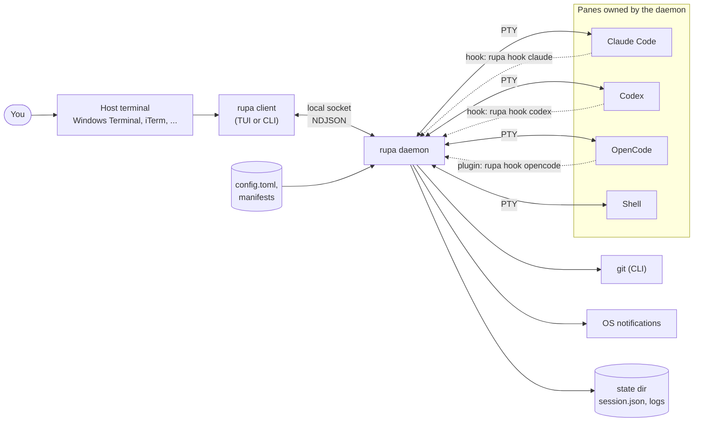

### 4.2 Process and thread model

One binary, three roles. The daemon is the only long-lived process.

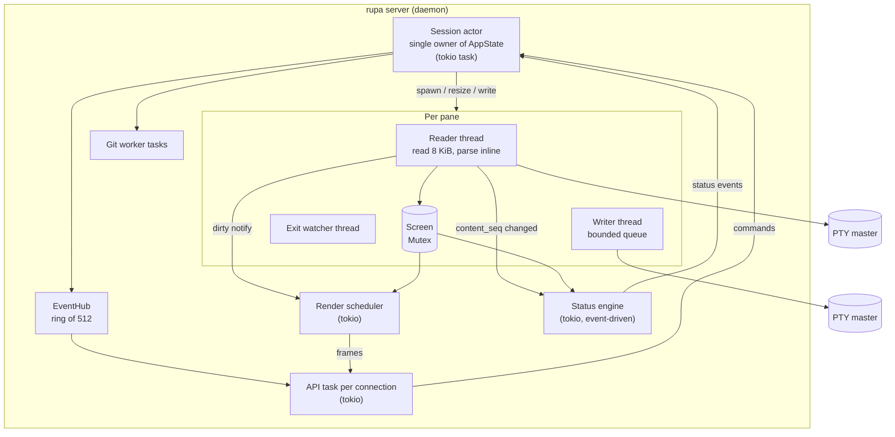

Rules: the actor never blocks (slow work goes to worker tasks); reader threads never wait on the actor; the screen mutex is held only to parse a chunk or to copy rows out.

### 4.3 Data model

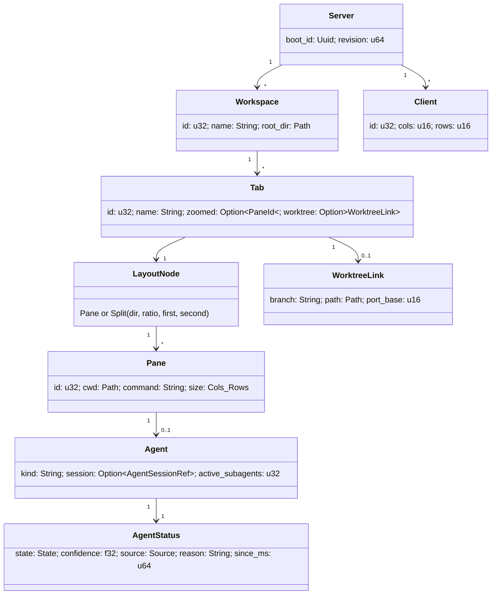

Ids are monotonic integers from a process-wide counter, **never reused** within a daemon boot, so persisted references stay stable across restores. **[V]** herdr does this.

### 4.4 Startup sequence

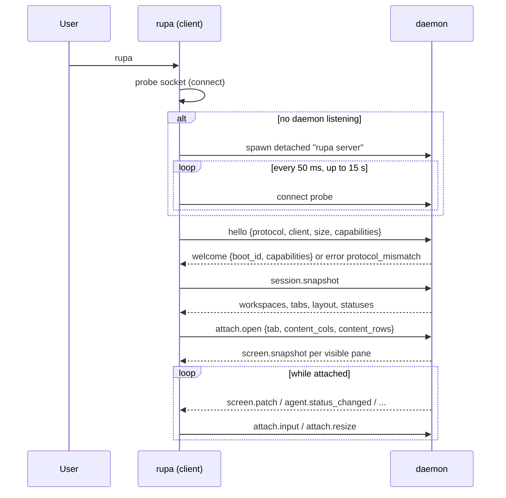

### 4.5 Crate layout

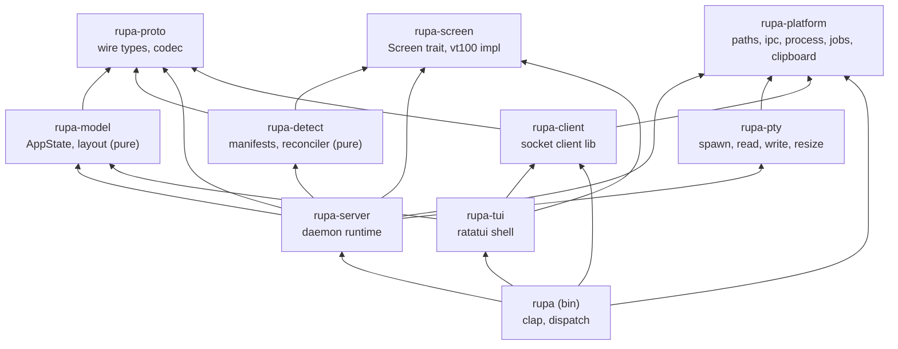

`bin --> platform` was added in P0-S4: process-wide setup (log file, crash file, `--version`) runs in the binary before any other crate starts and needs `rupa-platform::paths`.

| Crate | Responsibility | Pure (no I/O)? |
|---|---|---|
| `rupa-proto` | request/response/event types, error codes, NDJSON codec, schema | yes |
| `rupa-platform` | paths, config loading (`config.toml`), IPC endpoint, process identity, job objects, clipboard backends, **all `cfg(target_os)` code** | no |
| `rupa-pty` | PTY spawn, reader/writer threads, resize, exit | no |
| `rupa-screen` | `Screen` trait; `vt100` implementation; row hashing and patches | yes |
| `rupa-detect` | manifests, regions, gates, reconciler, hysteresis, rollup | **yes** |
| `rupa-model` | `AppState`, layout tree, command application, invariants | **yes** |
| `rupa-server` | actor, pane runtimes, render scheduler, status engine host, git worker, persistence | no |
| `rupa-client` | connect, handshake, request/response, event streams | no |
| `rupa-tui` | ratatui chrome, input handling, view model | no (but `render` is pure) |
| `rupa` | argv dispatch, CLI commands, hook/report subcommands, doctor | no |

### 4.6 Architecture invariants (copy into `AGENTS.md`)

Adapted from herdr's own `AGENTS.md`, which has kept a 270k-line codebase coherent. **[V]**

1. **State is separate from runtime.** `AppState`/`PaneState` are plain data constructible without a PTY (`AppState::test_new()`); `PaneRuntime` owns PTYs, threads and channels.
2. **Render is pure.** `compute_view()` does geometry and mutation; `render(&ViewModel)` only draws and returns a hit map.
3. **Platform isolation.** OS-specific code lives in `rupa-platform`. Elsewhere, `#[cfg(target_os)]` appears only on imports, struct fields, and match arms.
4. **Detection is decoupled.** The status engine reads a *screen snapshot of the live bottom rows*, never the parser, a viewport, or scrolled state.
5. **One actor owns mutable state.** Everyone else sends messages.
6. **No blocking on the actor or in render.** Slow work (git, process probes, clipboard tools) goes to workers with an operation id; a stale completion is ignored.
7. **Every queue is bounded**, and each has a documented overflow behaviour.
8. **Every side effect is verified before it is announced.** No "Copied" toast without a confirmed write; no "installed" without re-reading the file.
9. **Wire compatibility is a test, not a hope.** Hand-written fixture bytes for hello, welcome and errors.
10. **Unknown input is ignored, not fatal**: unknown JSON fields, unknown manifest keys, unknown escape sequences.

---

## 5. Detailed design

### 5.1 PTY and process management

**Spawn.** `SpawnSpec { program, args, cwd, env, size }` → `portable-pty` (`native_pty_system`). **[V]** `portable-pty` 0.9.0 is current and is what herdr uses, with four small Windows patches (§5.1.3).

**Environment given to every pane** (all `RUPA_*` plus terminal basics):

| Variable | Value | Used by |
|---|---|---|
| `TERM` | `xterm-256color` | programs |
| `COLORTERM` | `truecolor` | programs |
| `RUPA_ENV` | `1` | hooks (gate: only act inside rupa) |
| `RUPA_SOCKET_PATH` | endpoint path or pipe name | `rupa report`/`hook` |
| `RUPA_PANE_ID`, `RUPA_TAB_ID`, `RUPA_WORKSPACE_ID` | ids | hooks, scripts, agents |
| `RUPA_SESSION` | session name | CLI |
| `RUPA_TASK`, `RUPA_WORKTREE`, `RUPA_PORT_BASE` | set for task tabs | scripts |
| `RUPA_BIN_PATH` | absolute path of the rupa executable | hook commands |

The **daemon** builds this environment when it spawns a pane (P2-S5); a client never does. It also removes `RUPA_PANE_ID`/`RUPA_TAB_ID`/`RUPA_WORKSPACE_ID`, `TMUX` and `STY` inherited from whoever launched the daemon, so a pane never believes it lives somewhere else. Hooks exit silently when `RUPA_ENV` is missing, so a missing variable makes every hook a no-op with no error: `rupa doctor` checks it from inside a pane (P5-S7).

**Threads per pane** (std threads, not tokio, because `portable-pty` I/O is blocking): reader (8 KiB reads, parses inline under the screen mutex, bumps `content_seq`, signals `dirty`), writer (bounded queue of 1024; a full queue waits 50 ms then returns `Overflow`), exit watcher (emits `PaneExited(code)`).

**Resize.** Dedupe by value `(cols, rows, px_w, px_h)`; coalesce rapid requests so only the latest reaches the PTY. There is **no timer debounce** in herdr **[V]**; P1-S8 tests whether ConPTY needs one **[A]**, and the result goes into ADR-0004. After a resize, any terminal response the emulator generates is written *after* the resize is applied. **[V]** (herdr 0.6.9 #465/#471).

**Never resize PTYs to a fallback size when no client is attached.** They keep their last size so output is not rewrapped and history reflow is not triggered. **[V]** (herdr 0.5.3, 0.9.0 #3519).

**Exit.** The pane stays on screen with an "exited (code N)" banner until closed, so the last output is readable.

#### 5.1.1 Windows specifics (ConPTY)

| Topic | Rule | Status |
|---|---|---|
| Minimum OS | Windows 10 1809 (build 17763) for ConPTY | **[R]** |
| Cleanup | At daemon start put the **daemon itself** in a Job Object with `JOB_OBJECT_LIMIT_KILL_ON_JOB_CLOSE`, so every descendant inherits it with no assignment race (`portable-pty` does not expose `CREATE_SUSPENDED`, so assigning children after spawn leaves a window; nested jobs work on Windows 8+). Never do this in a client, or detaching would kill the agents. Per-pane kill = `ClosePseudoConsole` plus a process-tree walk | **[A]** nested-job behaviour under a launcher's own job, tested in P1-S5 |
| Ctrl-C | Do not use `GenerateConsoleCtrlEvent` on the shared console group; send `0x03` through the PTY instead | **[A]** |
| Split UTF-8 | Reads can end mid-codepoint; the parser is incremental | **[R]** |
| Handles | Do not leak daemon handles (sockets, pipes) into children | **[R]** |
| Shell resolution | `pwsh` → `powershell` → `cmd`. On this machine only Windows PowerShell 5.1 exists | **[V]** |
| Program lookup | Resolve with `is_file()`, not `exists()`; handle `.cmd`/`.exe` shims. herdr patched `portable-pty` for exactly this | **[V]** |
| Paste | A multi-line paste must be one bracketed paste, otherwise Claude Code submits on the first newline | **[V]** herdr 0.9.2 #4251 |
| Spawn quoting | Raw command tails for `cmd.exe /c` must keep their quoting | **[V]** herdr patch 0002 |

#### 5.1.2 Unix specifics

`setsid` per child; to kill a pane, close the PTY master (the kernel sends `SIGHUP`), wait a grace period, then `SIGKILL` **every process in the child's session** (an interactive shell puts background jobs in their own process groups, so `killpg` alone misses them); ignore `SIGHUP` in the daemon; handle `SIGTERM`/`SIGINT` as graceful stop. **[V]** for the daemon rules (herdr), **[A]** for the session kill.

#### 5.1.3 What herdr patched in `portable-pty` (reference for your own fixes)

1. Hash-verified app-local ConPTY bundle instead of whatever `conpty.dll` is on `PATH` (DLL hijack and version drift).
2. Raw command tail handling for `cmd.exe /c`.
3. Reject malformed registry-derived environment blocks.
4. Skip directories when resolving programs (`is_file()`).

All **[V]** from `vendor/patches/portable-pty/`. Start with upstream; apply the equivalent of 2–4 only when you hit the bug (P1-S2 tests), and consider 1 for V1.1.

---

### 5.2 Terminal emulation

#### 5.2.1 The `Screen` trait

```rust
pub trait Screen: Send {
    fn process(&mut self, bytes: &[u8]);            // feed PTY output
    fn resize(&mut self, cols: u16, rows: u16);
    fn size(&self) -> (u16, u16);
    fn cursor(&self) -> Cursor;                     // pos, visible, shape
    fn cell(&self, row: u16, col: u16) -> CellRef;  // for the client renderer
    fn tail_text(&self, rows: u16) -> Vec<String>;  // LIVE bottom rows, never the scrolled view
    fn snapshot(&self) -> Vec<u8>;                  // ANSI bytes that rebuild this screen
    fn row_patches(&self, prev: &mut RowHashes) -> Vec<RowPatch>;
    fn title(&self) -> Option<String>;
    fn modes(&self) -> Modes;                       // alt screen, app cursor, bracketed paste, mouse mode
    fn scrollback_len(&self) -> usize;
    fn scrolled_snapshot(&mut self, offset: usize) -> Vec<u8>;  // sets the view, formats it, ALWAYS restores offset 0 before returning
    fn take_signals(&mut self) -> Vec<Signal>;      // title, bell, OSC 7 / 9;4 / 133
    fn take_responses(&mut self) -> Vec<Vec<u8>>;   // replies to terminal queries; the caller writes them to the PTY in order
}
```

The trait has no generic methods so it stays usable as a trait object, but the hot path uses a concrete `enum AnyScreen { Vt100(..), Alacritty(..) }` behind a `Mutex`, which avoids vtable calls and sidesteps the unsized `Mutex<dyn Screen>` problem.

#### 5.2.2 `vt100` mapping **[V]** (API read from vt100 0.18.1 source)

| Need | vt100 API |
|---|---|
| Snapshot | `Screen::state_formatted()` / `contents_formatted()` |
| Optional whole-screen diff | `Screen::state_diff(&prev)` (needs a cloned `Screen`; see below) |
| Per-row formatted output | `Screen::rows_formatted(start, width)` |
| Modes | `alternate_screen()`, `application_cursor()`, `bracketed_paste()` |
| Scrollback | `scrollback_len()`, `set_scrollback(n)` (mutates the parser's view: set, format, and restore to 0 while holding the screen mutex; **never clone**, a clone copies all scrollback) |
| Title, bell, other OSC | `Callbacks::set_window_title`, `audible_bell`, `unhandled_osc`, `unhandled_csi` |
| Query replies (CSI 6n, DA, OSC 10/11, ...) | **no reply channel in vt100**: implement in the wrapper from `unhandled_csi` / `unhandled_osc`, reading the cursor from the `&mut Screen` the callback receives |
| Private modes vt100 does not track (`?1007` alternate scroll, DECSCUSR cursor shape, `?2026`) | `unhandled_csi`, tracked in the wrapper's own `Modes` |

**Diff strategy.** The default is **row hashing** (§5.3.2): hash each formatted visible row, send only the changed rows. `state_diff` needs a `Screen` clone per client per pane, and a clone includes scrollback, which would multiply memory. P1-S8 measures both and records the choice. **[A]**

#### 5.2.3 Fidelity checklist (Gate G1 — P1-S4)

| Item | Must pass for V1? | Why |
|---|---|---|
| Alternate screen enter/leave (`?1049`) with correct restore | **Must** | every agent TUI |
| 16/256/truecolor SGR, bold, italic, underline, reverse, dim | **Must** | |
| Wide chars (CJK) and emoji width, combining marks | **Must** | herdr bug cluster **[V: r5]** |
| Scroll regions and insert/delete line | **Must** | |
| Cursor visibility and position; cursor shape (DECSCUSR) | **Must** (shape: should) | |
| Bracketed paste mode tracking | **Must** | |
| Application cursor keys mode tracking | **Must** | |
| Mouse reporting modes (1000/1002/1003, SGR 1006) tracking, plus alternate-scroll `?1007` | **Must** | wheel routing (§5.7.3) |
| **Terminal query replies**: CSI 6n (cursor position), CSI c and CSI > c (device attributes), CSI ? u (answer "unsupported"), OSC 10/11 (colours from the theme palette), XTVERSION; replies are written to the PTY in order and after any pending resize | **Must** | Codex's and OpenCode's TUI stacks probe the terminal at startup and stall or misbehave without replies; herdr gets them from its emulator **[V]**, vt100 has none |
| OSC 0/2 title; OSC 7 cwd; OSC 9;4 progress; OSC 133 marks | **Must** (via callbacks) | status signals (§5.8) |
| Synchronized output `?2026` (must not tear; ignoring is acceptable) | Should | |
| OSC 8 hyperlinks | Should | |
| OSC 52 passthrough | Should (§5.12) | |
| Kitty keyboard protocol tracking | Not V1 | §12.2 |
| Kitty graphics, Sixel | Not V1 | |

If any **Must** item fails and cannot be fixed in the `vt100` wrapper within one slice, the `alacritty_terminal` implementation of `Screen` is written before G1 closes. **[V]** `alacritty_terminal` 0.26.0 exists on crates.io.

---

### 5.3 Attach and screen synchronisation

The daemon is the single source of truth. A client never parses raw PTY output. **[V]** (herdr design.)

#### 5.3.1 Flow

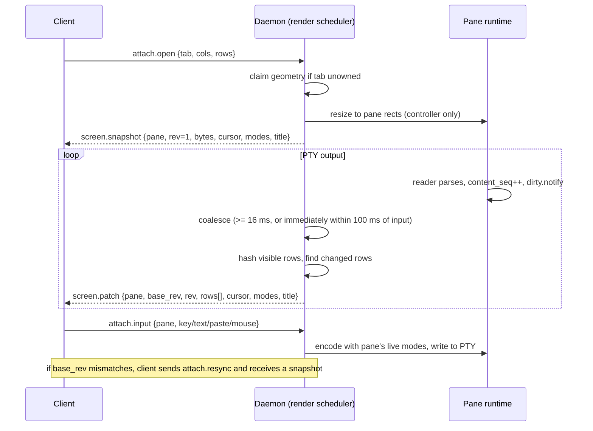

#### 5.3.2 Frame types

| Frame | When | Payload |
|---|---|---|
| `screen.snapshot` | first frame, size change, alt-screen flip, resync, client was scrolled | `bytes` = ANSI that rebuilds the whole screen; cursor; modes; title; `rev` |
| `screen.patch` | otherwise | `rows: [{y, bytes}]` where `bytes` = `ESC[0m` + `ESC[<y+1>;1H` + formatted row + `ESC[K`; cursor; modes; title; `base_rev`, `rev` |
| `screen.scrolled` | client is viewing scrollback | full snapshot of the scrolled view; no diffs until it returns to the live screen |

A patch applies only if `base_rev` equals the client's current `rev`; otherwise the client asks `attach.resync`. A patch frame never exceeds the snapshot's size: if it would, send a snapshot. **Never reuse a pre-reconnect screen.** **[V]** (herdr 0.9.1 #3903).

Per client and visible pane the server keeps **only** `RowHashes` and `rev`, not a screen copy.

#### 5.3.3 Scrolled view

Scroll offsets are **per client, per pane**. When a client scrolls, the server takes the pane's screen mutex, calls `set_scrollback(offset)` on the live parser, formats the visible rows, calls `set_scrollback(0)`, releases the mutex, and sends a full `screen.scrolled` frame. **No clone is made**: a `vt100` clone copies every scrollback row (about 13 MB per pane at the default, once per wheel tick). Detection reads the tail under the same mutex, so it never sees a non-zero offset. Returning to offset 0 sends a snapshot and resumes patches. Alternate-screen apps have no scrollback of their own; the 3-way wheel rule (§5.7.3) decides what the wheel does.

#### 5.3.4 Per-client write queue

Each client connection has two lanes:

| Lane | Content | Behaviour |
|---|---|---|
| **control** | responses, events, errors | always sent first; bounded; overflow disconnects the client with a logged reason |
| **render** | one slot, **latest frame wins** | a stalled client never accumulates frames; the scheduler replaces the pending frame and marks the baseline for a resync if a patch was dropped |

**[V]** (herdr `ClientWriterQueue`.) A write that makes no progress for 30 s closes the client.

#### 5.3.5 Geometry controller

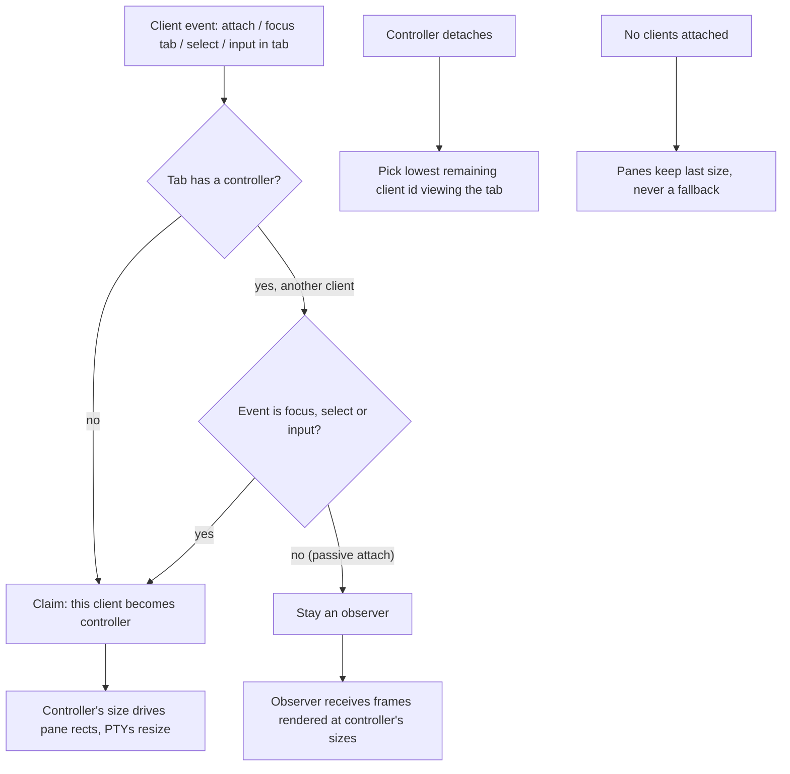

Rule in one sentence: **with one client, its size wins; with several, each tab follows the client that most recently focused or interacted with it.** **[V]** (herdr concepts doc and code.) Observers lay the received surface into their own area: an observer with a smaller content area clips at the bottom and right and shows a "smaller window" marker; a larger one leaves the extra space blank. No tmux-style minimum-size negotiation exists in herdr, and there is none here.

---

### 5.4 Protocol

#### 5.4.1 Transport and framing

- One local socket per session (Unix socket / Windows named pipe). Same-user only.
- **NDJSON**: one JSON object per line, UTF-8, max line **2 MiB** (`MAX_LINE`), checked before allocation. A longer line closes the connection with `invalid_request`.
- Unknown fields are ignored; unknown methods return `unknown_method` and keep the connection.
- The first message must be `hello` (5 s timeout).

#### 5.4.2 Envelope

```jsonc
// request
{"id":"c1","method":"pane.read","params":{"pane":7,"lines":40}}
// response
{"id":"c1","result":{"text":"..."}}
{"id":"c1","error":{"code":"not_found","message":"pane 7 does not exist"}}
// server-pushed event (no id)
{"event":"agent.status_changed","seq":1042,"data":{"pane":7,"state":"blocked","confidence":0.9,"reason":"permission: Bash rm -rf build"}}
```

Handshake:

```jsonc
{"id":"h","method":"hello","params":{"protocol":1,"client":"tui","version":"0.1.0","cols":200,"rows":50,"capabilities":["screen.patch","events"]}}
{"id":"h","result":{"protocol":1,"server_version":"0.1.0","boot_id":"b4f1…","capabilities":["screen.patch","events","agent.explain"]}}
{"id":"h","error":{"code":"protocol_mismatch","message":"client protocol 2, server protocol 1; run `rupa server stop` and retry"}}
```

**Content area.** `hello` carries the *terminal* size for information. `attach.open` and `attach.resize` carry `content_cols` and `content_rows`: the rectangle the client gives to panes **after** drawing its own chrome (sidebar, tab bar, status line). The server lays panes out inside that rectangle (§5.6); without it every pane would be wrong by the width of the sidebar.

**Versioning.** `protocol` is one integer and must match exactly (herdr: exact match **[V]**). Anything that can be optional is a **capability string**: a missing capability disables that feature only, never the connection. New JSON fields must be optional with defaults; new enum values need an `unknown` fallback on the receiving side. **[V]** (herdr's "frozen codecs" lesson.)

#### 5.4.3 Error codes

| Code | Meaning |
|---|---|
| `invalid_request` | malformed JSON, oversize line, missing field |
| `unknown_method` | method not registered |
| `protocol_mismatch` | version gate |
| `not_found` | pane/tab/workspace/task id does not exist |
| `invalid_state` | operation not legal now (for example `agent prompt` while blocked) |
| `operation_in_progress` | duplicate worktree create/remove for the same path |
| `busy` | actor did not answer within 5 s |
| `timeout` | waited method timed out |
| `events_lost` | subscriber fell behind the ring; resync with `session.snapshot` |
| `overflow` | input queue full |
| `permission_denied` | endpoint ACL or filesystem permission |
| `internal` | bug; includes a correlation id that is also in the log |

#### 5.4.4 Methods (V1 registry)

| Namespace | Methods |
|---|---|
| core | `hello`, `ping`, `server.status`, `server.stop`, `server.reload_config`, `server.reload_manifests` |
| session | `session.snapshot`, `session.list`, `session.stop` |
| structure | `workspace.{list,create,get,rename,focus,close}`, `tab.{list,create,get,rename,focus,close,move}`, `pane.{list,get,split,close,focus,zoom,resize,swap}` |
| pane I/O | `pane.read`, `pane.text` (lines with a wrapped flag, optionally including scrollback; used by copy mode and search), `pane.send_text`, `pane.send_keys`, `pane.run`, `pane.wait_output` |
| agent | `pane.report_agent`, `pane.report_session`, `pane.release_agent`, `agent.{list,get,wait,prompt,explain,focus,rename}` |
| task | `task.{new,done,list,gc}` |
| attach | `attach.{open,close,resync,input,resize,focus,scroll}` |
| events | `events.{subscribe,unsubscribe,wait}` |
| integration | `integration.{install,uninstall,status}` |
| misc | `notify.show`, `api.schema`, `api.snapshot` |

#### 5.4.5 Events

`pane.created|closed|exited`, `tab.*`, `workspace.*`, `agent.status_changed`, `agent.identified|released`, `task.created|done`, `output.matched`, `notification`, `server.shutdown`. Each carries a monotonic `seq`. The hub keeps the last **512**; requesting a `seq` older than the ring returns `events_lost`, and the client must resubscribe and call `session.snapshot` — it must never invent missed events. **[V]** (herdr `EventHub`; $\text{lost} \iff s_{\text{last}} < s_{\text{head}} - 512$.)

#### 5.4.6 Limits

| Limit | Value |
|---|---|
| Line size | 2 MiB |
| `hello` timeout | 5 s (local) |
| Actor response timeout | 5 s |
| Paste size | 1 MiB default (config) |
| Events ring | 512 |
| Pane input queue | 1024 chunks |
| Concurrent clients | 16 [A] |

---

### 5.5 Daemon lifecycle

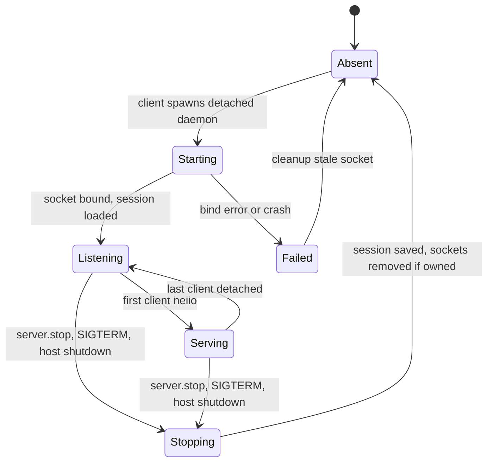

**Detached spawn** — the part that breaks on Windows:

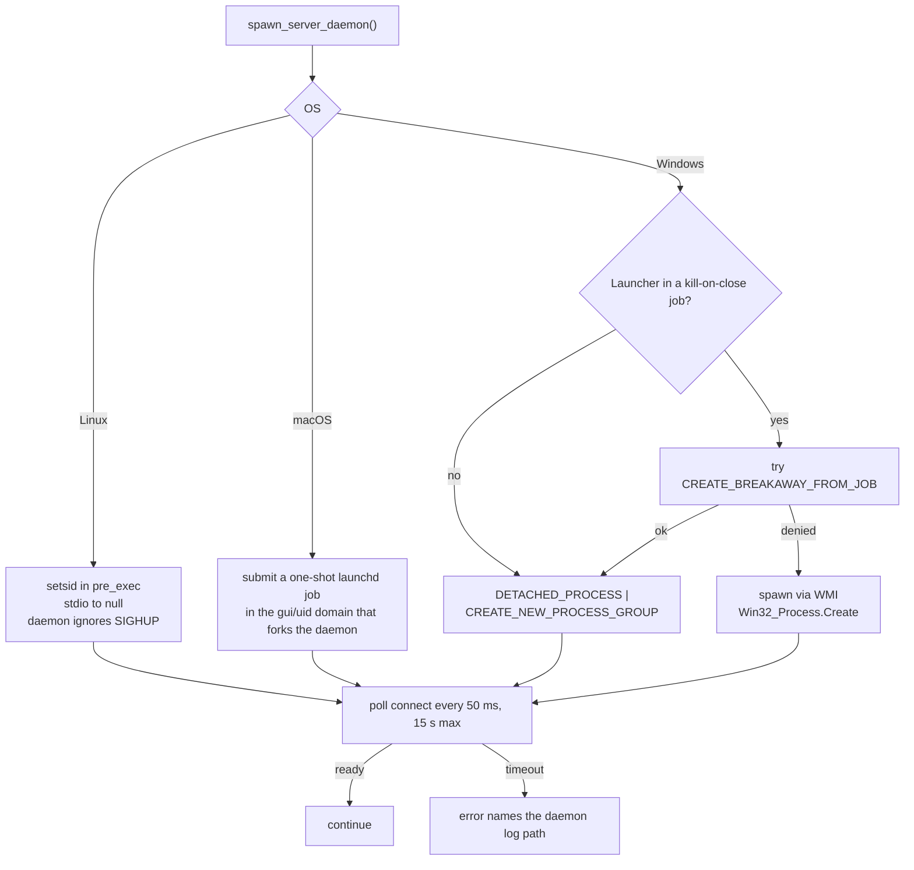

**[V]** `DETACHED_PROCESS` plus the WMI fallback are what herdr does (`launch_server_daemon_with_wmi`). **[A]** `CREATE_BREAKAWAY_FROM_JOB` is a cheaper first attempt that P2-S3 tests; keep WMI if it fails.

**macOS.** A process started from a terminal stays in that app's launchd job and coalition even after `setsid`, and dies when the user quits the terminal app. herdr submits a one-shot job to the GUI launchd domain that forks the server (`launchd_spawn.rs`, herdr #4920). **[V]** Port that approach in P2-S3 and test Cmd-Q.

**Windows WMI path.** A process created through WMI `Win32_Process.Create` does **not** inherit the caller's environment or cwd; pass the full environment block and the cwd explicitly (herdr `launch_server_daemon_with_wmi`). **[V]**

**Stale endpoints.** An endpoint is stale if connecting returns *connection refused* or *not found* (also *timed out* / *would block* on Windows). Remove only stale endpoints; any other error propagates. On exit the daemon removes its endpoint **only if the recorded identity still matches** (Unix `(dev, ino)`; Windows marker-file bytes). **[V]**

**Version mismatch.** The client prints an actionable message and exits. It never kills the running daemon. **[V]**

**Stop.** The first reason (signal, API caller pid and name, host shutdown) wins and is logged once. Order: tell clients, wait 50 ms for writers, set quit, save the session (before panes are torn down, so interrupted exits do not overwrite it with an empty session **[V]** herdr 0.8.x #3415), remove endpoints. `server.stop` is handled outside the actor channel so it works even if the actor is wedged. **[V]**

---

### 5.6 Layout engine

Binary tree: `Node = Pane(id) | Split { dir, ratio r, first, second }`. A `Vertical` split puts `first` on the left; `Horizontal` puts it on top.

**Rectangle computation.** For a split along an axis of length $L$ cells, with a 1-cell divider and minimum child size $m$ (default: 8 columns, 3 rows **[A]**):

$$L' = L - 1,\qquad s_1 = \min\!\Big(\max\big(\lfloor rL' + 0.5 \rfloor,\; m\big),\; L' - m\Big),\qquad s_2 = L' - s_1$$

A split is refused if $L' < 2m$. The children tile exactly: $s_1 + 1 + s_2 = L$.

**Stored ratio is clamped** to $0.1 \le r \le 0.9$. **[V]** herdr.

**Drag resize.** Moving the divider by $\Delta$ cells changes the nearest ancestor split whose direction matches the axis:

$$r' = \operatorname{clamp}\!\left(\frac{s_1 + \Delta}{L'},\; 0.1,\; 0.9\right)$$

Only that one ratio changes; sibling subtrees are untouched. **[V]**

**Operations.** *Split*: replace the leaf with `Split{first: existing, second: new}`. *Close*: replace the parent split with the surviving sibling (no rebalancing). *Swap*: exchange two leaves' pane ids; shape and ratios stay. *Zoom*: a flag on the tab, not a tree change; the zoomed pane's PTY is resized to the full content area and the layout sizes are restored on unzoom. *Focus after close*: previously focused pane, else the first leaf in order. **[V]**

**Property to test:** for any tree and any size where every split is allowed, the leaf rectangles are pairwise disjoint and cover the area minus dividers exactly.

---

### 5.7 Input

#### 5.7.1 Key path

The client sends **semantic** events (key code, modifiers, text, paste, mouse); the **server** encodes them for the target pane using that pane's *live* modes, because only the server knows each pane's state. **[V]** (herdr design.)

| Input | Encoding (xterm-style, V1) |
|---|---|
| Printable | UTF-8 text |
| Ctrl+letter | `0x01`–`0x1A` |
| Alt+key | `ESC` + key |
| Enter / Tab / Backspace / Esc | `\r` / `\t` / `\x7f` / `\x1b` |
| Shift+Tab | `ESC [ Z` |
| Arrows, Home, End | `ESC [ A…` or `ESC O A…` when application-cursor mode is on |
| PgUp, PgDn, Ins, Del | `ESC [ 5~`, `6~`, `2~`, `3~` |
| F1–F12 | xterm sequences |
| Modified special keys | `ESC [ 1 ; <mod> <final>` |
| Paste | wrapped in `ESC[200~ … ESC[201~` if the pane enabled bracketed paste |
| Shift+Enter | **decided in P1-S7** after testing against real agents **[A]** |

A **lease table** keyed by `(client, key)` makes a key release or repeat go to the pane that received the press, even if focus changed in between. **[V]** (herdr `InputLeaseTable`, changelog 0.9.)

App-level bindings must not steal keys applications use. Direct (non-prefix) bindings are few and opt-in. **[V: r5 bug 3]**

#### 5.7.2 Prefix state machine

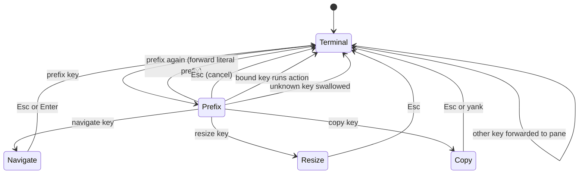

There is **no prefix timeout**: Prefix stays until a key arrives. Pressing the prefix twice sends the literal key. **[V]** (herdr `ClientShellMode`.)

Default bindings (prefix = `ctrl+b`; all configurable):

| Key | Action | Key | Action |
|---|---|---|---|
| `c` | new tab | `%` / `"` | split vertical / horizontal |
| `n` / `p` | next / previous tab | arrows or `h j k l` | focus pane |
| `shift+n` | new workspace | `z` | zoom pane |
| `shift+g` | new worktree task | `x` | close pane |
| `w` | workspace picker | `,` | rename tab |
| `a` | **inbox** | `;` | **jump to next blocked** |
| `[` | copy mode | `d` | detach |
| `e` | diff popup | `1`…`9` | switch tab |
| `?` | key list | `:` | command palette |
| `space` | navigate mode | `r` | resize mode |

#### 5.7.3 Mouse and wheel

Hit-test order: overlays → chrome (sidebar, tab bar, dividers, buttons) → pane. A pane hit is forwarded **only if the pane enabled mouse reporting**, in SGR format, with pane-relative coordinates.

Wheel routing is a 3-way decision from the pane's live modes **[V]**:

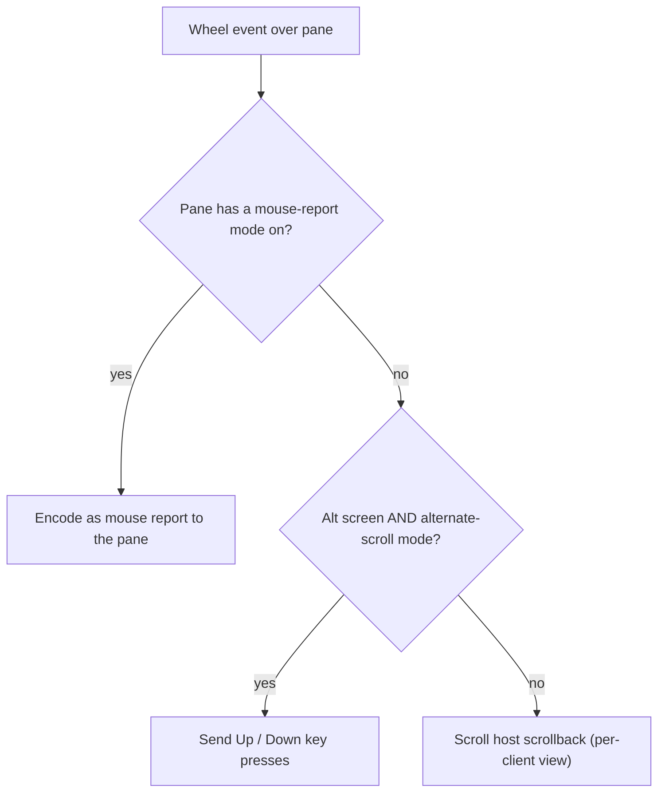

Mouse capture on the host terminal is dynamic: on when the UI wants the mouse **or** the focused pane requests reporting. Empty encodings are never written to the PTY. **[V]**

---

### 5.8 Agent status engine

This is the product. Everything else exists to host it.

#### 5.8.1 States and rollup

| State | Meaning |
|---|---|
| `blocked` | the agent needs a human answer or approval |
| `working` | the agent is making progress (including background subagents) |
| `done` | finished while you were not looking; cleared when you focus the pane |
| `idle` | at its prompt, nothing pending, and already seen |
| `unknown` | an agent is identified but no signal exists |

Plain shells have **no status**. Rollup is the maximum under the order

$$\text{blocked} \succ \text{working} \succ \text{done} \succ \text{idle} \succ \text{unknown}, \qquad S(W) = \max_{p \in W} \operatorname{rank}(s_p)$$

for a tab or workspace $W$. A transition `working → idle` while the pane is not focused becomes `done`.

#### 5.8.2 Signals

| # | Signal | Reliability prior $\rho$ | Source |
|---|---|---|---|
| 1 | **Hook** (agent-reported edge events) | 0.95 **[A]** | `rupa hook` / `rupa report` |
| 2 | **OSC title / progress** (spinner glyphs, "Action Required") | 0.90 **[A]** | emulator callbacks |
| 3 | **Screen manifest** (rules over the live bottom rows) | 0.80 **[A]** | `rupa-detect` |
| 4 | **Quiescence** (time since last PTY output) and generic prompt patterns | 0.50 **[A]** | pane runtime |

A manifest evaluation yields at most **two** signals: the best `title`/`progress`-region rule (signal 2, $\rho = 0.90$) and the best screen-region rule (signal 3, $\rho = 0.80$). Each is chosen by priority within its own group and they count separately in the confidence formula.

Process identification decides *whether* a pane has an agent and *which* manifest applies; it is not a state signal. **[V]** (herdr splits identification from detection.)

#### 5.8.3 The reconciler

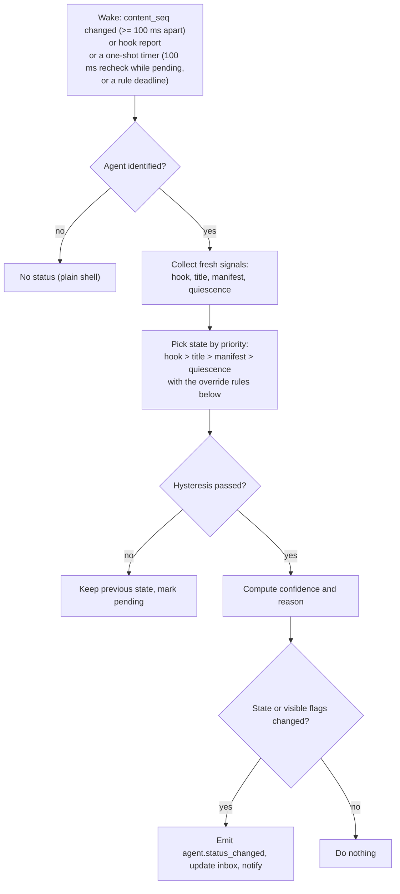

**Override rules** (a lower-priority signal beats a higher one only in these cases):

| Case | Rule |
|---|---|
| Hook says `blocked`, and either (a) input was sent to the pane after the report (the user answered) or (b) a blocked manifest rule matched during this episode and has stopped matching for $\ge T_{\text{clear}} = 1.5\,\text{s}$ | follow the screen. A blocked state the manifests never recognised (an OpenCode question, a new dialog wording) is **not** cleared by silence |
| Hook says `working` or `blocked`, screen shows the idle prompt for $\ge T_{\text{stale}} = 5\,\text{s}$ with no PTY output | `idle` with reason "hook stale" (a `Stop` was missed) |
| Hook says `working`/`idle`, screen shows a **strong blocked** dialog | `blocked` (a `PermissionRequest` hook was missed, for example an untrusted Codex hook) |
| Hook says `idle`, screen shows a live spinner or interrupt hint | `working` (a `UserPromptSubmit` was missed, or a background task) |
| Identified agent, no manifest match, output within 2 s | `working`, $\rho = 0.5$ |
| Identified agent, no manifest match, silence | `unknown`, **never `idle`** (silent thinking must not look idle) |
| `active_subagents > 0` when main `Stop` arrives | stay `working`, reason "waiting for N background agents" (§5.9.1) |

**Hysteresis** (asymmetric, because a false *idle* is the costly error). It applies to **screen-derived** signals only (title, manifest, quiescence); **hook edges are accepted immediately** because they are events, not samples. A *sample* is one evaluation, and the first evaluation counts as sample 1. While a transition is pending the engine arms a one-shot timer at $\Delta = 100\,\text{ms}$ and re-arms it per sample, because a static dialog produces no further output to trigger an evaluation.

$$\text{accept}(s \to s') = \begin{cases} \text{immediately} & s' = \text{working, or any hook edge} \\ k_b = 2 \text{ consecutive samples} & s' = \text{blocked (from the screen)} \\ k_i = 3 \text{ consecutive samples, } \Delta = 100\,\text{ms apart,} & \\ \quad \text{or the pending age reaches } T_{\text{cap}} = 700\,\text{ms} & s' = \text{idle, no explicit idle-prompt match} \\ 1 \text{ sample} & s' = \text{idle, an idle-prompt rule matched} \end{cases}$$

Initial values $k_i, \Delta, T_{\text{cap}}$ are herdr's (3 confirmations at 100 ms, 700 ms cap) **[V]**. herdr applies the hold **only** to a working→idle change with no visible idle prompt and no visible blocker (`!visible_idle && !visible_blocker` in `agent_detection.rs`); rupa does the same, so an idle conclusion backed by an explicit idle-prompt rule is accepted after one sample. $k_b$ and the other values are **[A]**, calibrated in P4-S10.

**Confidence.** Let $A$ be the fresh signals that agree with the chosen state:

$$c = 1 - \prod_{i \in A}\,(1 - \rho_i)$$

If the highest-priority fresh signal *disagrees* with the chosen state (an override fired), apply a conflict penalty and flag it:

$$c \leftarrow \max(c - 0.3,\; 0.2), \qquad \text{conflict} = \text{true}$$

Display bands: $c \ge 0.9$ "sure", $0.6 \le c < 0.9$ "likely", $c < 0.6$ "guess". The noisy-OR assumes independent signals, which they are not; the numbers are for **ordering and display**, not probabilities. **[A]**

**Truth table** (each row is a P4-S6 test):

| # | Hook | Title | Manifest | Quiescence | Result | $c$ |
|---|---|---|---|---|---|---|
| 1 | working | – | working | – | working | 0.99 |
| 2 | working | – | none | – | working | 0.95 |
| 3 | working | – | **blocked (strong)** | – | blocked, conflict | 0.50 |
| 4 | idle | – | idle | – | idle | 0.99 |
| 5 | idle | – | none | – | idle | 0.95 |
| 6 | idle | – | **working** | – | working, conflict | 0.50 |
| 7 | working | – | idle ≥ 5 s | silent | idle ("hook stale"), conflict | 0.50 |
| 8 | blocked | – | a blocked rule matched earlier, now none for ≥ 1.5 s (or input was sent) | – | the screen-derived state: manifest winner, else `working` if output ≤ 2 s, else stay `blocked`; conflict | ≤ 0.5 |
| 16 | blocked | – | no blocked rule ever matched | silent | stay `blocked` (hook-only, for example an OpenCode question) | 0.95 |
| 9 | none | working | working | – | working | 0.98 |
| 10 | none | working | – | – | working | 0.90 |
| 11 | none | – | blocked | – | blocked | 0.80 |
| 12 | none | – | none | output ≤ 2 s | working | 0.50 |
| 13 | none | – | none | silent | unknown | – |
| 14 | none | – | none | prompt-like text (`[y/n]`) | blocked | 0.50 |
| 15 | working (Stop arrives) | – | – | – | working while `active_subagents > 0` | 0.95 |

**Detection latency** is bounded by

$$t_{\text{detect}} \;\le\; \Delta_{\text{coalesce}} + (k_b - 1)\,\Delta_{\text{timer}} + t_{\text{render}} + t_{\text{notify}} \;\approx\; 100 + 100 + 16 + 10 \;\text{ms} \approx 0.23\,\text{s} \;\ll\; 1\,\text{s}$$

for a hook-less blocked dialog; a hook edge skips the sampling terms entirely.

**Calibration metrics** (SC2). For each labelled interval $j$ with duration $d_j$ and true state $y_j$:

$$\text{recall}_{\text{blocked}} = \frac{TP}{TP + FN}, \qquad \text{FIR} = \frac{\sum_j d_j\,[\,y_j = \text{working} \wedge \hat{s}_j = \text{idle}\,]}{\sum_j d_j\,[\,y_j = \text{working}\,]}$$

Targets: $\text{recall}_{\text{blocked}} \ge 0.98$ and $\text{FIR} \le 0.01$.

**Evaluation is event-driven**: only when a pane's `content_seq` changed (coalesced to at most one evaluation per 100 ms) or a hook arrived, plus a one-shot 100 ms timer armed only while a transition is pending, and one-shot timers at the deadline of any time-threshold rule ($T_{\text{clear}}$, $T_{\text{stale}}$, the 2 s output window, the subagent guard). herdr's idle server woke about 16 times a second **[V: r5 #5994]**; this design has no polling loop. §5.16.3 gives the budget.

**Detection input.** The last $N = 24$ rows of the **live** screen **[V]**, regardless of any scrolled viewport.

#### 5.8.4 Manifests

TOML, one file per agent. Bundled with `include_str!`; user overrides in `<config_dir>/manifests/<agent>.toml`; reload with `rupa server reload-manifests`; test with `rupa manifest test <manifest> <capture> --at <offset>`. **[V]** (herdr has the same three layers.)

```toml
id = "example"
version = "2026.11.15.1"           # bump on every change
aliases = ["example-cli"]

[[rules]]
id = "permission_dialog"           # shown in `agent explain`
state = "blocked"                  # idle | working | blocked | unknown
priority = 980                     # higher wins
region = "after_last_rule"
reason = "permission dialog"
contains = ["esc to cancel"]
any = [ { contains = ["enter to confirm"] }, { contains = ["enter to select"] } ]
not = [ { contains = ["transcript"] } ]
```

| Key | Meaning |
|---|---|
| `region` | `title`, `progress`, `tail(N)`, `tail_nonempty(N)`, `top_nonempty(N)`, `after_last_rule`, `prompt_box`, `above_prompt_box`, `whole_tail` |
| `contains`, `regex`, `line_regex` | literal / multiline regex / per-line regex; all listed matchers must hit |
| `all`, `any`, `not` | nested gates |
| `skip_state_update` | rule matches but must not change state (transcript viewer, model picker) |
| `reason` | text shown in the inbox |

Regions: `after_last_rule` = text after the last horizontal-rule line (a line made mostly of `─`, `━`, `═`, or `-`, at least 10 wide); `prompt_box` = text between the last two rules. **[V]** herdr uses the same idea.

**Limits** (protect against hostile or broken overrides) **[V]**: 128 rules per manifest, gate depth 8, 512 gates, 32 matchers per gate, 1,024 matchers total, 512 characters per matcher. A manifest that violates them is rejected with a clear error and the bundled one stays active.

**Patterns that matter** **[V: r6]**: *conjunction gating* for ambiguous footers (for example `esc to cancel` alone is a working hint **and** a blocked footer; require it **plus** `enter to select`); *negative gates* so a background-task banner cannot hide a real dialog; *priority bands* (**[A]**: herdr's real Claude manifest uses idle 950, bash-permission blocked 850 and legacy rules around 300, so only consistency within one manifest matters).

Example rules are in Appendix A; derive the real strings from your own golden captures (P4-S3), because CLI wording drifts.

#### 5.8.5 Process identification

Per pane, walk the child process tree (`sysinfo`), match executables to profiles and the built-in list; unwrap `node`/`bun`/`python` scripts by reading the command line. Cadence per pane: every 500 ms for the first 1.5 s after spawn, every 2 s until 8 s, then every 5 s while identified and every 30 s while unidentified (herdr `PROCESS_RECHECK_MISSING_FOREGROUND_GROUP` **[V]**); drop an identification only after 6 consecutive misses; a 3 s startup grace window avoids flapping. **All panes due in the same tick share one process-table snapshot**, cached for 250 ms: on Windows every snapshot is a full process scan, so per-pane scans would break the CPU budget (§5.16.3). **[V]** constants from herdr; **[A]** for rupa until P4-S10.

---

### 5.9 Agent integrations

All hooks run **`rupa hook <agent>`** (D7): it reads the agent's JSON on stdin, sends one report over the socket (150 ms connect timeout), and **always exits 0** within a 400 ms hard wall-clock deadline enforced by a watchdog thread, so a broken rupa can never break an agent. Outside a rupa pane (`RUPA_ENV` unset) it does nothing in under 5 ms.

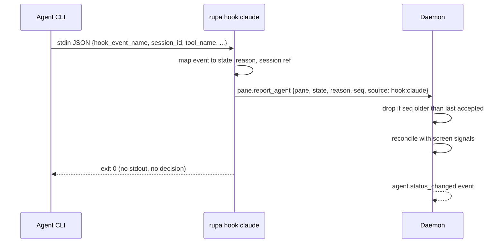

#### 5.9.1 Claude Code **[R]** (official docs read by research)

| Hook event | Reported state / action |
|---|---|
| `SessionStart` (sources `startup`, `resume`, `clear`, `compact`, `fork`) | record session ref (`session_id`, `transcript_path`); no state change |
| `UserPromptSubmit` | `working` |
| `PermissionRequest` | `blocked`, reason `permission: <tool_name> <short tool_input>` — **immediate** |
| `PostToolUse`, `PostToolUseFailure` | `working` (clears a granted or denied dialog) |
| `Stop`, `StopFailure` | `idle`, unless `active_subagents > 0` |
| `SubagentStart` / `SubagentStop` | `active_subagents` ± 1 |
| `Notification` with `notification_type` `elicitation_dialog` or `elicitation_url_dialog` | `blocked`, reason "question" |
| `SessionEnd` | release the agent |

Facts that shape the table **[R]**: `Notification/permission_prompt` fires only after about **6 s** without typing, and `idle_prompt` about **60 s** after finishing, so **neither is a fast edge**; `PermissionRequest` and `Stop` are. Any payload with `agent_id` came from a subagent. From such a payload only `PermissionRequest` and elicitation `Notification` set `blocked` (a subagent's dialog still needs you; the reason is prefixed with the subagent type); `SubagentStart`/`SubagentStop` adjust the counter; its other events are ignored for the main state. Hook timeouts are in **seconds** (default 600); we set 5.

**Subagent counter.** Each pane's `Agent` keeps `active_subagents`. It resets on `SessionEnd`, and is cleared after 30 minutes with no event (stuck counter guard **[A]**). This addresses herdr's most-reported bug class: panes that read idle while background subagents still run (#4511, #5004, #5934 **[V: r5]**).

*Unverified before building:* that an empty-stdout, exit-0 `PermissionRequest` hook leaves Claude's own dialog untouched; the exact quoting when Claude Code on Windows runs the hook command; the cost of a hook per `PostToolUse` call (native binary expected at about 10 ms). All checked in P5-S2/S3.

#### 5.9.2 Codex CLI **[R]**

| Hook event | State |
|---|---|
| `SessionStart` | session ref |
| `UserPromptSubmit` | `working` |
| `PermissionRequest` | `blocked` |
| `PostToolUse` | `working` |
| `Stop`, `Interrupt` | `idle` |
| `SessionEnd` | release |

Config in `~/.codex/hooks.json` (or `[hooks]` in `config.toml`, never both in one layer). A **one-time trust review** (`/hooks`) is required for non-managed hooks; `--dangerously-bypass-hook-trust` skips it. `commandWindows` supplies the Windows command. Timeouts in seconds; `SessionEnd`/`Interrupt` default to 1 s. Until trust is granted, hooks silently do nothing, which is exactly the "hook missed" case the reconciler's override rules handle. `rupa doctor` reports it. **[R]**

#### 5.9.3 OpenCode **[R]; plugin shape [A]**

A JS plugin at `~/.config/opencode/plugins/rupa-agent-state.js` calls `rupa hook opencode`:

| Event | State |
|---|---|
| `chat.message` (plugin hook) | `working` |
| `tool.execute.before/after`, `permission.replied`, `question.replied`, `question.rejected`, `session.compacted` | `working` |
| `permission.asked`, `question.asked`, `session.error` | `blocked` |
| `session.idle` | `idle` |
| `session.status` | map `idle` → idle; `active`, `busy`, `pending`, `retry`, `running`, `streaming`, `working` → working |

Child sessions (`properties.info.parentID`) report against the **root** session.

**What herdr actually does** **[V]**: its *server* plugin returns no hooks unless the process owns its local lifecycle (`opencode run`, or `--mini` without `serve`/`web`/`attach`); the full TUI reports through a **separate TUI plugin** (`herdr-tui-session.js`, registered in `tui.jsonc`/`cli.json` by `opencode_config.rs`) because a shared server or TUI worker cannot tell which session its pane is showing. Its JS also connects to the socket directly (`net.createConnection`, `\\.\pipe\` prefix on Windows) instead of spawning a process per event. P5-S5 decides server-plugin versus TUI-plugin against the *installed* OpenCode, and spawning `rupa hook` per event (about 20–50 ms on Windows) should be replaced by a direct socket write if it is noticeable. Gate the plugin on `RUPA_ENV=1`, and skip `serve`, `web`, `attach`, and `--attach` invocations, which cannot identify their pane. **[V]** The event names are a version-pinned contract, not a documented public API. **[A]**

#### 5.9.4 Everyone else (V1: screen-only)

Gemini CLI (consumer tiers deprecated June 2026 **[R]**), Cursor CLI, GitHub Copilot CLI, Amp, Aider. Amp and Aider expose no usable hook (Aider's only signal is a notification command) **[R]**. Provide a generic profile; add manifests in V1.1. Hook formats for Cursor/Copilot/Gemini are in `r6-agent-hooks.md` for later.

#### 5.9.5 Resume

| Agent | Resume command (to verify in P5-S6) |
|---|---|
| Claude Code | `claude --resume <session_id>` (`-r`); `--continue` for the latest **[R]** |
| Codex | `codex resume <session_id>` **[A]**; `codex exec resume` is the non-interactive form **[R]** |
| OpenCode | `opencode --session <id>` **[A]** (r6 could not confirm) |

All three CLIs are installed on this machine **[V]** (`claude`, `codex`, `opencode`), so P5-S6 verifies each against `--help` and records the working form in the default config. If the profile has no verified template, restore starts a fresh agent and says so. Restore **spawns the resume command directly as the pane's program** (the same path as `rupa new`), not by typing it into a restored shell, so quitting the agent shows the exit banner rather than a shell. herdr's open bugs here: restoring a new chat instead of the old one (#5921), a restart after `/branch` returning the pre-branch conversation (#5909), and wrong cwd (#3116). **[V: r5]**

#### 5.9.6 Installers

`rupa integrate <agent> [--scope user|project] [--status|--uninstall]`: back up the file to `*.rupa-bak`; refuse invalid JSON or duplicate keys; identify our entries by the `rupa hook` command prefix; change nothing else; `--status` re-reads the file to confirm; `--uninstall` removes only ours. The hook command uses `$RUPA_BIN_PATH`'s absolute path recorded at install time so it works without `PATH` (re-run `integrate` after moving the binary; `doctor` detects drift).

---

### 5.10 Worktrees and tasks

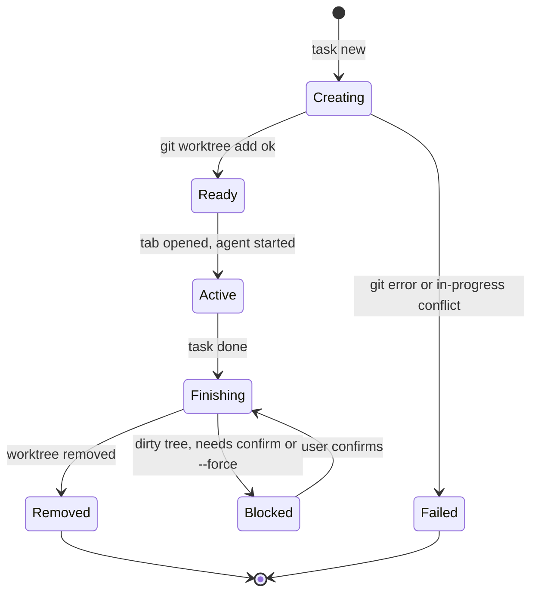

#### 5.10.1 Commands **[V]** (herdr's exact set)

```
git -C <repo> show-ref --verify --quiet refs/heads/<branch>   # exists? exit 0 yes, 1 no
git -C <repo> worktree add -b <branch> <path> <base>          # new branch (base default HEAD)
git -C <repo> worktree add <path> <branch>                    # existing branch
git -C <repo> worktree remove [--force] <path>
git -C <repo> worktree list --porcelain
git -C <repo> rev-parse --git-common-dir
git -C <repo> status --porcelain --untracked-files=all
git -C <repo> rev-list --left-right --count <head>...<upstream>
```

All with `LC_ALL=C` (failures are classified from English text: "contains modified or untracked files", "is not a working tree"). On Windows no console window flashes.

#### 5.10.2 Naming and cleanup

Path: `<worktrees_dir>/<repo>/<slug(branch)>`, default `~/.rupa/worktrees`. Slug: lowercase ASCII alphanumerics, runs of anything else become one `-`, trimmed, fallback `worktree`. Auto branch: `task/<adjective>-<noun>-<hex4>`. Orphan guard: a leftover directory is deleted only if its `.git` file points under `<git-common-dir>/worktrees`. **[V]** On Windows, stop the workspace's PTYs first or the directory stays locked. **[V]**

#### 5.10.3 Ports

Each task gets a block of $B = 20$ ports starting at $\text{base}_k = P_0 + k\,B$ with $P_0 = 21000$, kept below the OS ephemeral range (Linux default 32768, Windows 49152):

$$K = \left\lfloor \frac{32768 - P_0}{B} \right\rfloor = \left\lfloor \frac{11768}{20} \right\rfloor = 588 \text{ concurrent tasks}$$

Blocks are exported as `RUPA_PORT_BASE` and reused after `task done`. (herdr users and the Hyve README list port collisions as a top multi-agent pain **[V: r5]**.)

---

### 5.11 Persistence and restore

`<state_dir>/session.json` (schema version 1). **No terminal bytes** inside, and `active_subagents` is deliberately not persisted (it resets on restore); scrollback restoration is out of V1 (herdr keeps a separate compressed history file; rupa skips it).

```jsonc
{
  "version": 1,
  "saved_at": "2026-11-15T10:00:00Z",
  "workspaces": [{
    "id": 1, "name": "api", "root": "C:/work/api",
    "tabs": [{
      "id": 3, "name": "fix-login",
      "layout": {"split":"v","ratio":0.5,"first":{"pane":7},"second":{"pane":8}},
      "focus": 7, "prev_focus": [8], "zoomed": null,
      "worktree": {"branch":"task/fix-login","path":"C:/Users/me/.rupa/worktrees/api/fix-login","port_base":21000},
      "panes": [
        {"id":7,"cwd":"C:/.../fix-login","profile":"claude","command":"claude","args":[],"agent_session":{"agent":"claude","id":"abc123","path":".../abc123.jsonl"}},
        {"id":8,"cwd":"C:/.../fix-login","profile":null}
      ]
    }]
  }]
}
```

**Atomic write:** temp file in the same directory → `fsync` → atomic replace → `fsync` the directory. Keep 3 rolling backups. Saves are debounced (≤ one per 2 s) and forced on graceful shutdown **before** panes are torn down. Refuse to load a newer `version`; a missing file means "nothing to restore". **[V]** (herdr `persist/io.rs`.)

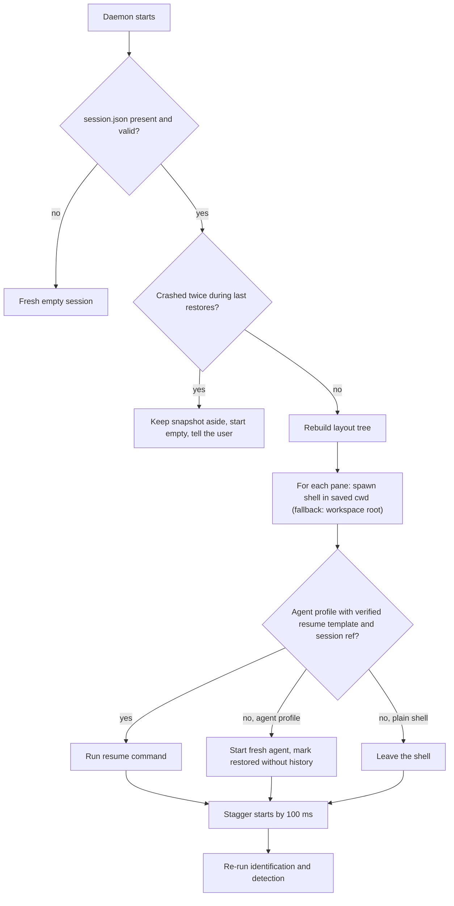

---

### 5.12 Notifications

Trigger: a pane's status changes to `blocked` or `done` while it is not focused (or the client is not focused). Channels: terminal bell, OSC 9/777 passthrough to the host terminal, desktop toast. Content includes the **why**. Rules:

| Rule | Detail |
|---|---|
| One alert per event | one sound or toast, not one per attached client **[V: r5 #4787]** |
| Rate limit per pane | at most one per $T_n = 30\,\text{s}$; the first event after a longer silence always fires |
| Global mute | `rupa notify mute [duration]` |
| Low-confidence blocked | $c < 0.6$ notifies only after the second confirming sample |
| Verified side effects | never claim a notification or copy happened without a confirmed result **[V: r5 bug 2]** |

Pane-originated OSC 52 clipboard writes are honoured only per config (`clipboard.osc52_from_panes = "write" | "off"`; default `write`). Empty writes are ignored. **[V]** (herdr 0.8.0 #1893).

---

### 5.13 Configuration

`<config_dir>/config.toml`: Windows `%APPDATA%\rupa\config.toml`; elsewhere `$XDG_CONFIG_HOME/rupa/config.toml`. Override with `RUPA_CONFIG_DIR`. Unknown keys warn. `rupa config default` prints this file.

Load order: built-in defaults, then the user file, then `RUPA_*` overrides, then CLI flags. `RUPA_SESSION` and `--session <name>` override `server.session`; a present `[[agents]]` list replaces the built-in one rather than merging entry by entry. A syntax error is reported with its line and column: `rupa config check` exits 1, while normal startup logs the error and runs on the defaults, so a typo cannot brick the daemon.

```toml
[server]
session = "default"
startup_per_agent_delay_ms = 100
max_clients = 16

[ui]
theme = "dark"                  # dark | light | high-contrast
sidebar_min_width = 18
sidebar_max_width = 36
mouse = true
render_min_interval_ms = 16

[keys]
prefix = ["ctrl+b"]            # a list; Claude Code binds ctrl+b to "background this command", so double-tap sends it through, or add e.g. "ctrl+space"
# new_tab = "prefix+c"

[terminal]
scrollback_lines = 2000         # P1-S8 may change the default
paste_limit_bytes = 1048576

[clipboard]
osc52_from_panes = "write"      # write | off
prefer_osc52 = false

[detect]
tail_rows = 24
tick_coalesce_ms = 100
idle_confirmations = 3
idle_confirm_interval_ms = 100
idle_confirm_cap_ms = 700
blocked_confirmations = 2
hook_stale_ms = 5000
blocked_clear_ms = 1500
manifest_dir = ""               # default: <config_dir>/manifests

[notify]
desktop = true
bell = true
osc = true
rate_limit_s = 30
muted = false

[worktrees]
directory = "~/.rupa/worktrees"
branch_prefix = "task/"
port_base = 21000
port_block = 20

[[agents]]
name = "claude"
command = "claude"
args = []
env = {}
resume = "claude --resume {id}"     # verified in P5-S6

[[agents]]
name = "codex"
command = "codex"
resume = "codex resume {id}"        # verify

[[agents]]
name = "opencode"
command = "opencode"
resume = "opencode --session {id}"  # verify
```

---

### 5.14 CLI surface

```
rupa                                  attach (auto-start daemon)
rupa server [start|stop|status|reload-config|reload-manifests]
rupa session [list|stop]
rupa workspace|tab|pane  list|create|get|focus|rename|close|split|zoom|resize|swap
rupa new [--profile P] [--dir D] [--name N]
rupa task [new|done|list|gc]
rupa pane read|send-text|send-keys|run|wait-output
rupa agent [list|get|wait|prompt|explain|focus|rename]
rupa report ...                       (used by hooks)
rupa hook <claude|codex|opencode>     (used by hooks)
rupa integrate <agent> [--status|--uninstall] [--scope user|project]
rupa events [--kind ...]
rupa manifest test <manifest> <capture> [--at OFFSET]
rupa notify [show|mute|unmute]
rupa top
rupa doctor [--json]
rupa config [default|path|check]
rupa keys
rupa api [schema|snapshot]
rupa detect eval <timeline>            (detection metrics on golden captures)
rupa update --check                    (the only network call; manual)
rupa detach
rupa completions <shell>

Global: --session <name>   (every command; default session is "default")
```

Exit codes: 0 ok · 1 error · 2 usage · 3 not found · 4 daemon not running · 5 timeout. Add `--json` to any listing for machine output.

---

### 5.15 Security and privacy

#### 5.15.1 Threat model

| Asset | Threat | Mitigation |
|---|---|---|
| Terminal I/O and the ability to type into agents | another local user connects to the socket | Unix `0600` and directory `0700`; Windows pipe DACL limited to the current user; verify on each OS (P8-S5) |
| Same-user malware | sends keystrokes through the API | out of scope (it already can read your files); document |
| Agent config files | installer corrupts or hijacks them | backup, validation, ours-only edits, `--status` re-read |
| Hook command | path injection or quoting bug runs the wrong program | store the absolute path; quote per OS; test paths with spaces |
| Manifest overrides | pathological regex stalls the daemon | hard limits (§5.8.4), `regex` crate (no catastrophic backtracking), per-evaluation time budget |
| Recorded captures | contain secrets | `captures/` is git-ignored; redaction pass; never attach raw captures to issues |
| Paste and `send-keys` | a script injects commands into an agent | `agent prompt` refuses when the agent is blocked unless `--force`; paste size limit |
| Network | any outbound traffic | none by default (D11); `rupa update --check` is the only network call and is manual |

#### 5.15.2 Privacy rules

No telemetry, no analytics, no accounts, no crash upload. Logs stay local and never contain pane contents (only ids, states, and rule names).

#### 5.15.3 Sign-off checklist (P8-S5)

- [ ] Endpoint permissions verified per OS.
- [ ] One-hour network capture shows zero outbound connections (SC8).
- [ ] Installer tested with spaces, Unicode, and CRLF in paths and files.
- [ ] Manifest limits enforced; a hostile manifest is rejected.
- [ ] `cargo audit` and `cargo deny` clean in CI.
- [ ] No secrets in the repo (scan `tests/golden/`).

---

### 5.16 Performance and resource budgets

#### 5.16.1 Latency

$$L_{\text{echo}} = t_{\text{enc}} + t_{\text{ipc}}^{c \to s} + t_{\text{pty}} + t_{\text{parse}} + t_{\text{hash}} + t_{\text{ipc}}^{s \to c} + t_{\text{apply}} + t_{\text{draw}} \;\le\; 30\,\text{ms (p95)}$$

| Term | Budget **[A]** |
|---|---|
| encode | 0.1 ms |
| IPC each way | 0.3 ms |
| child echo through PTY (ConPTY is the largest unknown) | 1–8 ms |
| parse | 0.2 ms |
| hash changed rows | 0.5 ms |
| apply + draw | 3–5 ms |
| **Sum (typical)** | **≈ 6–16 ms** |

Rendering is event-driven with a minimum interval $\Delta_{\min} = 16\,\text{ms}$, i.e. $f_{\max} = 1/0.016 = 62.5\,\text{Hz}$. After any input event the scheduler **skips the minimum interval for 100 ms** so a keystroke's echo is never delayed by the cap. **[V]** (herdr `MIN_RENDER_INTERVAL` 16 ms plus an interactive window). Users of 120/144 Hz displays ask for more (#1134, 33 reactions) **[V: r5]**; the interval is configurable.

#### 5.16.2 Memory

$$M_{\text{daemon}} \;\approx\; M_0 + N_p \cdot b_{\text{cell}} \cdot c\,(r + S)$$

with $N_p$ panes, $c$ columns, $r$ rows, $S$ scrollback lines, $b_{\text{cell}}$ bytes per cell, and $M_0$ the daemon's fixed overhead. `vt100::Cell` is exactly 32 B (asserted in its source **[V]**); the worked example uses a conservative $b_{\text{cell}} = 48\,\text{B}$ ceiling for row overhead and heap spill **[A: measured in P1-S8]**, so the real figure at the default is expected near 13 MB per pane, $M_0 = 30\,\text{MB}$, $c = 200$, $r = 50$:

| $S$ | Per pane | 10 panes + $M_0$ |
|---|---|---|
| 500 | $48 \cdot 200 \cdot 550 = 5.3$ MB | ≈ 83 MB |
| **2,000** | $48 \cdot 200 \cdot 2050 = 19.7$ MB | **≈ 227 MB** |
| 5,000 | $48 \cdot 200 \cdot 5050 = 48.5$ MB | ≈ 515 MB |

The default $S = 2000$ stays within the SC4 budget (< 300 MB for 10 panes); 5,000 lines would not. herdr compresses scrollback in the terminal core and caps it at 10 MB per terminal **[V]**; rupa starts with a **line cap** and revisits compression only if measurement says so. Per-client cost is `RowHashes` (about $8\cdot r$ bytes per pane), not a screen copy.

#### 5.16.3 Idle wakeups

With event-driven evaluation, an idle fleet wakes the daemon only for housekeeping:

$$W_{\text{idle}} = \frac{1}{T_{\text{probe}}} + \frac{N_{\text{unid}}}{T_{\text{slow}}} + f_{\text{housekeeping}} + \phi_{\text{pend}}\,\frac{1}{\Delta} = \frac{1}{5} + \frac{2}{30} + 0.2 + 0 \approx 0.47\;\text{wakeups/s} \;\le\; 5$$

where one aligned tick of period $T_{\text{probe}} = 5\,\text{s}$ serves **all** identified agents from a single process snapshot, $N_{\text{unid}}$ unidentified shells are probed every $T_{\text{slow}} = 30\,\text{s}$ (the example is 8 agents plus 2 shells), $f_{\text{housekeeping}} = 0.2\,\text{Hz}$, and $\phi_{\text{pend}}$ is the fraction of time a transition is pending ($\approx 0$ for an idle fleet; one pending transition adds at most $T_{\text{cap}}/\Delta = 7$ wakeups).

#### 5.16.4 Output flood

A pane producing $\lambda_{\text{out}}$ bytes/s costs parse time linear in $\lambda_{\text{out}}$ on its reader thread only. Frame rate is capped at $f_{\max}$ regardless of $\lambda_{\text{out}}$, and a stalled client holds one frame (§5.3.4). No unbounded queue exists anywhere between the PTY and the client.

---

### 5.17 Observability

- `tracing` to rotating files in `<state_dir>/logs/`; `RUPA_LOG=debug`. Never to stdout/stderr in TUI mode.
- `rupa top`: per-pane CPU, RSS, output rate, status; daemon totals.
- `rupa agent explain <pane>`: every signal, its freshness, the rule that matched (with manifest id and version), the override that fired, hysteresis state, and the final confidence.
- `rupa doctor --json`.
- Crash reports in `<state_dir>/crash-*.txt`; pane panics are isolated and shown as a banner (P8-S4).

---
## 6. Technology

### 6.1 Principles

1. **Boring dependencies.** Prefer crates that herdr, zellij or wezterm already prove in production (`portable-pty`, `interprocess`, `ratatui`, `crossterm`, `tokio`).
2. **Threads for blocking PTY I/O, tokio for everything else.** `portable-pty` readers and writers are blocking.
3. **Shell out to `git`.** One fewer C dependency, and full fidelity with the user's git setup.
4. **Run `cargo add <crate>`; never copy a version from a document**, including this one. Research reports in this project were wrong about versions once already (§2.4).

### 6.2 Platform matrix

| Concern | Windows | Linux | macOS |
|---|---|---|---|
| PTY | ConPTY via `portable-pty` | `openpty` | `openpty` |
| IPC | Named pipe `\\.\pipe\rupa-<user>-<session>` plus marker file | Unix socket, mode `0600` | same as Linux |
| Daemon detach | `DETACHED_PROCESS`, breakaway or WMI fallback | `setsid`, ignore `SIGHUP` | one-shot launchd job in the `gui/<uid>` domain (`setsid` alone dies when the terminal app quits) **[V]**, ported in P2-S3 |
| Child cleanup | Job Object (`KILL_ON_JOB_CLOSE`) in the daemon | `killpg` | `killpg` |
| Default shell | `pwsh` → `powershell` → `cmd` | `$SHELL` → `/bin/sh` | `$SHELL` → `/bin/zsh` |
| Clipboard | `arboard` or Win32 | `wl-copy`, `xclip`, `xsel` | `pbcopy` |
| Notifications | toast via `notify-rust` | `notify-rust` (D-Bus) | `notify-rust` |
| Paths | `%APPDATA%`, `%LOCALAPPDATA%` | XDG | `~/Library/Application Support` via `directories` |
| Build | MSVC Build Tools **required** **[V]** | gcc/clang | Xcode CLT |
| Release | x64 | x64 (glibc and musl), arm64 | x64, arm64 |

Not in V1: Windows ARM64 (herdr has a dedicated workflow for it **[V]**), BSDs.

### 6.3 Dependency list (versions from `cargo search` on 2026-11-14)

| Domain | Crate | Version | Used by | Notes |
|---|---|---|---|---|
| TUI | `ratatui` | 0.30.2 | tui | **[V]** same major as herdr |
| Host terminal | `crossterm` | 0.29.0 | tui, bin (panic-hook restore) | key and mouse events; herdr removed it on Windows in 0.9.4 for native console records **[V]**, so Windows key fidelity is a P1-S7 test, not an assumption |
| PTY | `portable-pty` | 0.9.0 | pty | herdr vendors patches (§5.1.3) |
| Emulator | `vt100` | 0.18.1 | screen | D3; API checked **[V]** |
| Emulator fallback | `alacritty_terminal` | 0.26.0 | screen | only if G1 demands it |
| Async | `tokio` | 1.54.1 | server, client | `rt-multi-thread`, `sync`, `time`, `process`, `io-util`, `macros` |
| IPC | `interprocess` | 2.4.8 | platform | `tokio` feature; same crate herdr uses **[V]** |
| Serialisation | `serde`, `serde_json` | 1.0.229, 1.0.154 | all | |
| Config | `toml` | 1.2.1 | platform (config) | note: major 1, not 0.8 as in r4 |
| Schema | `schemars` | 1.2.3 | proto | `api schema` |
| CLI | `clap` (+ `clap_complete`) | 4.6.7 (4.6.11) | bin | derive |
| Paths | `directories` | 6.0.0 | platform | |
| Errors | `thiserror`, `anyhow` | 2.0.21, 1.0.104 | libs, bin | |
| Logging | `tracing`, `tracing-subscriber`, `tracing-appender` | 0.1.44, 0.3.23, 0.2.5 | all | file only |
| Processes | `sysinfo` | 0.40.3 | detect host | tree walk for identification |
| Regex | `regex` | 1.13.1 | detect | linear-time matcher |
| Windows API | `windows` | 0.62.2 | platform | Job Objects, security descriptors, process queries |
| Unix API | `nix` (or `rustix` 1.1.6) | 0.32.0 | platform | `setsid`, `killpg`, signals. **Do not depend on `libc` directly**: its newest published version is an alpha **[V]** |
| Notifications | `notify-rust` | 4.19.0 | server | |
| Clipboard | `arboard` | 3.7.0 | platform | if it fails the "verified" rule, shell out instead |
| WMI (fallback spawn) | `wmi` | 0.18.4 | platform | only if breakaway fails (§5.5) |
| Utilities | `uuid`, `bytes`, `which`, `ctrlc`, `tokio-util` | 1.29.2, 1.12.1, 8.0.6, 3.5.2, 0.7.20 | various | |
| Testing | `insta`, `assert_cmd`, `tempfile`, `proptest` | 1.49.0, 2.2.2, 3.27.0, 1.12.0 | dev | |
| Tooling | `just`, `cargo-deny`, `cargo-audit`, `cargo-nextest` | 1.59.0, 0.20.2, 0.23.0 | dev, CI | |

**Considered and not used in V1:** `base64` (row patches and snapshots are valid UTF-8 and travel as JSON strings), `bincode` (v3 now; NDJSON suffices), `notify` file watcher (9.0.0 is still a release candidate; manifests reload on command), `git2` (C toolchain pain on Windows, weak worktree support), `agent-client-protocol` 5.2.0 and `rmcp` 3.10.0 (§12.2), `tui-term` 0.3.4 (it binds to `vt100`'s screen type; write a 100-line widget instead so the `Screen` trait stays swappable).

### 6.4 Reference: what herdr depends on (for orientation) **[V]**

`ratatui 0.30`, `crossterm 0.29`, vendored `portable-pty`, bundled `ghostty-vt`, `tokio` (multi-thread), `interprocess 2.4.2`, `serde`/`serde_json`, `bincode 2`, `clap 4.5`, `tracing`, `toml` + `toml_edit`, `jsonc-parser`, `regex`, `sha2`, `schemars`, `zbus` (Linux logind), `windows`/`windows-sys`/`wmi` (Windows), `signal-hook` (Unix), `png`, `unicode-width`, `unicode-segmentation`.

---

## 7. Making it better than herdr (and what comes after V1)

### 7.1 Differentiators included in V1

Ranked by evidence in `r5-user-demand.md` and by cost.

| # | Improvement | Evidence | Where |
|---|---|---|---|
| 1 | **Explainable status**: every state carries a source, a reason and a confidence; `agent explain` shows the full decision | false-idle is herdr's most-reported bug class (8+ issues) | §5.8, P4-S6, P4-S8 |
| 2 | **Subagent-aware lifecycle**: a main `Stop` does not mean idle while background agents run | #4511, #5004, #5934 | §5.9.1 |
| 3 | **Native hook binary**: no `python3`, `bash` or PowerShell dependency; starts in milliseconds | herdr's scripts shell out to `python3` **[V]** | D7, P5-S2 |
| 4 | **Zero polling when idle**: event-driven status, no 16 Hz idle loop | #5994, #3217 | §5.16.3, P8-S3 |
| 5 | **Verified side effects**: no "Copied" toast unless the write is confirmed; no empty-clipboard overwrites | 7+ clipboard issues | P3-S7 |
| 6 | **Golden-capture regression for detection**, with a metrics harness and `manifest test` | herdr explicitly *avoids* freezing CLI screens and relies on live smoke tests **[V]**; recorded captures give you a measurable alternative | P4-S3, P4-S10 |
| 7 | **tmux nesting guard** | HN: "launched it from within tmux… gave up" | P3-S8 |
| 8 | **Per-profile env isolation** (two Claude accounts side by side) | discussion #4683 | P3-S8 |
| 9 | **Worktree-grouped sidebar**, per-task port blocks | HN: the single most-repeated want; Hyve and Conductor praise | P6-S3, P6-S4 |
| 10 | **Inbox with the "why"** (and jump to next blocked) | HN: "hotkey for the next idle worker" | P4-S8 |
| 11 | **`rupa top`** resource view | #3217, discussion #5978 | P8-S3 |
| 12 | **Honest README**: "what this is not" | the tmux objection | P8-S7 |
| 13 | **No telemetry, no network** | HN telemetry threads | D11 |

### 7.2 Backlog after V1 (ordered)

| Release | Item | Size | Notes |
|---|---|---|---|
| **V1.1** | Manifests for Gemini, Cursor, Copilot, Amp, Aider | S each | formats in `r6-agent-hooks.md` |
| V1.1 | **Permission inbox with inline approve** (send the approving key, show the dialog text first, confirm) | L | the most-cited cross-tool pain; builds on `PermissionRequest` payloads |
| V1.1 | `tmux` import (sessions → workspaces) | M | adoption blocker |
| V1.1 | Diff review loop: comment in the diff popup → `agent prompt` | M | praised in vibe-kanban and herdr-reviewr |
| V1.1 | Sidebar folders; focus-follows-mouse; PageUp and key-fidelity fixes | S each | most-upvoted ideas (30 and 23 votes) |
| V1.1 | Session recording and `rupa replay` (reuse the capture tool) | S | cheap, useful for bug reports |
| V1.1 | Snooze or mute an agent | S | |
| V1.1 | Kitty keyboard protocol | M | modern key fidelity |
| V1.2 | SSH multi-machine with attach-only mode and diff-based sync | L | herdr's remote bandwidth bug: 3.6 GB/hour (#4264) |
| V1.2 | Dev-server health checks and orphan cleanup | M | |
| V1.2 | Scrollback persistence across restore | M | |
| V2 | Local merge queue and conflict assistance | L | |
| V2 | Sandboxing (devcontainer per agent) | L | |
| V2 | ACP host mode, MCP server exposing the runtime | L | only when agents commonly speak them |
| V2 | Plugin system (with a sandbox story) | L | needs installed base |
| V2 | Cost and usage view | M–L | no stable cross-agent data source yet |
| V2 | Mobile or web companion | L | five third-party clients already exist for herdr |

### 7.3 Things to avoid (from other tools' failures)

| Do not | Because |
|---|---|
| Ship a UI redesign that removes a view | vibe-kanban #2687: 33 reactions and 39 comments |
| Require GitHub OAuth or any account | "hard NO" on HN |
| Default telemetry on | recurring thread |
| Let an installer silently rewrite agent config | trust; back up, show, and undo |
| Corrupt the user's tmux/terminal state | AoE reports; never touch other tools' state |
| Treat silence as idle | the whole false-idle problem |
| Announce success before verifying | clipboard bugs |
| Resize PTYs to a fallback size | reflow storms (herdr #3519) |

---
## 8. Delivery plan — phases and slices

### 8.1 How to read this section

- A **phase** is a milestone with a gate. A **slice** is the smallest independently shippable increment: it compiles, it has a test, and it can be merged on its own.
- A slice header looks like this: `#### P2-S3 · Title · **L** · deps: P2-S1, P2-S2`.
- **Task** bullets are atomic: each should take roughly 15–90 minutes. If one takes longer, split it and write the split down.
- **Done when** is the acceptance test. A slice is not done until it passes. Gate slices are marked **GATE**.
- **Size scale** (one focused working day = ~5 productive hours): **XS** = 0.25 d · **S** = 0.5 d · **M** = 1 d · **L** = 2 d. Anything bigger than L must be split before you start it.
- Evidence tags used throughout: **[V]** verified in source, docs, or on this machine · **[R]** reported by research, not independently verified · **[A]** assumption to be validated by the slice that owns it.

### 8.2 Slice execution protocol (use it for every slice)

1. Branch `p<phase>-s<slice>-<slug>`; read the slice's linked spec section (§5.x) first.
2. Write the failing test (or fixture) named in **Done when**.
3. Implement the tasks in order; commit after each green task.
4. Run `just check` (fmt, clippy `-D warnings`, tests) on your dev OS; push; CI must be green on all three OSes.
5. Update the spec if reality disagreed with it (see §12.3). Bugs in the spec are slice-sized work too.
6. Merge; tick the boxes in `docs/progress.md`.

**Prompt template if you delegate a slice to a coding agent:** "Implement slice `<ID>` from `TECH_SPEC.md` §8. Read §5.<n> and Appendix A first. Do only the listed tasks. Add the tests in *Done when*. Follow `AGENTS.md`. Do not add dependencies not listed in §6.3."

---

### Phase 0 — Foundations

Goal: a green, boring, three-OS workspace you never have to think about again. **Gate G0:** `cargo check --workspace` and CI green on Windows, Linux and macOS.

#### P0-S1 · Toolchain and dev environment · **S** · deps: —
- [x] Install the C++ build tools: the "Desktop development with C++" workload (MSVC and Windows 11 SDK). Done 2026-11-18 with Visual Studio 2026 Community (18.x) and SDK 10.0.26100; `cargo build --workspace` links and `cargo test --workspace` passes from PowerShell. Visual Studio 2022 Build Tools also works. **[V]** This machine has no `link.exe`, and the only other C toolchain is 32-bit MinGW, which does not work for the default Rust target.
- [x] Build from PowerShell or cmd, **not** Git Bash. **[V]** Git Bash puts GNU `link` on `PATH` and it shadows MSVC `link.exe`, which breaks every build script.
- [x] `rustup component add rustfmt clippy`; add `rust-toolchain.toml` (channel `stable`; the machine currently has 1.94.0).
- [x] Install `just`; optionally `cargo-nextest`. Done: just 1.59.0, nextest 0.9.152.
- [x] Write `docs/dev-setup.md` with the exact commands and the Git Bash caveat.
- **Done when:** a fresh `cargo new hello && cargo run` succeeds from PowerShell.

#### P0-S2 · Workspace skeleton · **S** · deps: P0-S1
- [x] Create the root `Cargo.toml` workspace with `resolver = "3"`, `edition = "2024"`, and `[workspace.dependencies]`.
- [x] Create empty crates: `rupa-proto`, `rupa-platform`, `rupa-pty`, `rupa-screen`, `rupa-detect`, `rupa-model`, `rupa-server`, `rupa-client`, `rupa-tui`, and the binary crate `rupa` (§4.5).
- [x] Add `tools/pty-capture` and `tests/fake-agent` as workspace members.
- [ ] Add dependencies with `cargo add` (never copy versions from documents). Pin them in `[workspace.dependencies]`. Partly done: each slice added its own third-party dependencies with `cargo add` in the crate's own `Cargo.toml` (`rupa-platform`, `rupa`, `rupa-pty`, `rupa-proto`, `rupa-server`), but `[workspace.dependencies]` still pins only the path crates. Remaining: move those third-party versions into `[workspace.dependencies]` and switch the crates to `workspace = true`.
- [x] Add a `justfile`: `check`, `test`, `fmt`, `run`.
- **Done when:** `cargo check --workspace` is green; `cargo tree -d` reports no unexpected duplicates.

#### P0-S3 · CI matrix · **S** · deps: P0-S2
- [ ] Add a GitHub Actions workflow with a matrix of `windows-latest`, `ubuntu-latest` and `macos-latest`.
- [ ] Steps: `cargo fmt --check`, `cargo clippy --workspace --all-targets -- -D warnings`, `cargo test --workspace`.
- [ ] Add `Swatinem/rust-cache`.
- [ ] Add a path filter so docs-only changes skip the build.
- **Done when:** a trivial PR is green on all three OSes.

#### P0-S4 · Paths, logging, panic hook · **S** · deps: P0-S2
- [x] In `rupa-platform::paths`, resolve `config_dir` and `state_dir` via `directories`. **Spec correction [V]:** `directories` 6.0.0 returns a state dir only on Linux. Windows and macOS fall back to `data_local_dir` (Windows: `%LOCALAPPDATA%\rupa\data`, kept off the roaming profile). On macOS that equals `config_dir`, so state goes in a `state/` subfolder: wiping state must never delete the user's config.
- [x] Resolve `runtime_dir` yourself: `directories` returns `None` for it on macOS, on Windows, and on Linux without `XDG_RUNTIME_DIR`. Linux: `$XDG_RUNTIME_DIR/rupa`, else `/tmp/rupa-<uid>` (mode 0700, owner checked). macOS: `$TMPDIR/rupa-<uid>`. Windows: pipe name only, with its marker file under `%LOCALAPPDATA%\rupa`.
- [x] Assert the final socket path is shorter than 100 bytes (`sun_path` is 104 on macOS) and fail with a clear message otherwise.
- [x] Allow `RUPA_CONFIG_DIR`, `RUPA_STATE_DIR` and `RUPA_RUNTIME_DIR` overrides (tests depend on them).
- [x] Add `tracing` plus `tracing-appender` file logging to `<state_dir>/logs/`, with `RUPA_LOG` for the level. Never log to stdout or stderr in TUI mode. (Daily files, 7 kept; an unparsable `RUPA_LOG` falls back to `info`.)
- [x] Add a panic hook that writes `<state_dir>/crash-<ts>.txt` and restores the terminal (leave alternate screen, disable raw mode, show cursor). Restore runs first; the file is `crash-<unix ms>-<pid>.txt`; if it can't be written the report goes to stderr.
- [x] Add `rupa --version` that prints version, commit and target. (`build.rs` stamps `RUPA_COMMIT`, 12 hex or `unknown`, and `RUPA_TARGET`; `--version`/`-V` run before any setup and create nothing.)
- **Done when:** a forced panic in a test binary leaves a crash file and a sane terminal.

#### P0-S5 · Config loader · **S** · deps: P0-S4
- [x] Define `Config` structs with `#[serde(default)]` everywhere (§5.13). Lives in `rupa-platform::config`: that crate owns `config_dir`, and the `bin --> platform` / `server --> platform` edges already exist, so no new crate or edge.
- [x] Load order: built-in defaults, then user file, then `RUPA_*` env overrides, then CLI flags. (`RUPA_SESSION` and `--session` are the only overrides §5.13 defines today; the seam is `Config::resolve`.)
- [x] Warn (do not fail) on unknown keys; report parse errors with line and column. (Unknown keys come back as dotted paths such as `ui.colour`; `rupa config check` prints them to stdout as well as `tracing`.)
- [x] Add `rupa config default | path | check`. (Hand-parsed argv, consistent with `--version`; `default` and `path` create nothing.)
- **Done when:** unit tests cover defaults, an override, an unknown key and a syntax error. (`rupa-platform` `config::tests`, plus `crates/rupa/tests/config_cmd.rs` for the commands.)

#### P0-S6 · Repo hygiene · **XS** · deps: P0-S2
- [x] Add `AGENTS.md` with the architecture invariants from §4.6. (verified item by item; added the missing `PaneRuntime` clause to invariant 1)
- [x] Add `docs/adr/` with a template; record ADR-0001 (own daemon, not tmux) and ADR-0002 (name, licence).
- [x] Add `LICENSE-MIT` and `LICENSE-APACHE`, and a `NOTICE` that credits herdr for any adapted material.
- [x] Add `.gitignore` entries for `target/`, `captures/` (recordings can contain secrets), and `*.rupa-bak`.
- [x] Remove strays from the repo: add `reference/herdr/src/` to `.gitignore` and record where the reference clone lives in `docs/dev-setup.md` (this spec cites its paths, so keep it readable); delete the duplicate `r4-rust-stack.md` at the repo root.
- **Done when:** `git status` is clean after a build. (verified: `git status --short` identical before and after `cargo build --workspace`; no new entries)

---

### Phase 1 — Terminal core and the fidelity gate

Goal: prove, on this machine, that PTY + emulator + key encoding can host real agent CLIs before you build anything on top. **Gate G1:** ADR-0003 records the emulator decision with evidence from real captures of Claude Code, Codex and OpenCode.

#### P1-S1 · Capture and replay tool · **M** · deps: P0-S2
- [ ] Move `spikes/pty-capture/` (written, **never built**) to `tools/pty-capture` and fix whatever fails to compile.
- [ ] Keep `capture <out> <secs> <cols> <rows> <storm> <cmd…>` and `replay <in> <cols> <rows>`.
- [ ] Add a `--keys "<script>"` option that sends timed input, e.g. `wait:3s send:\r wait:2s`.
- [ ] Add a redaction pass that scans for token-shaped strings and emails and refuses to save an unredacted capture into `tests/golden/`.
- [ ] Capture 12 s of startup for `claude`, `codex` and `opencode` at 120×40 into `captures/`.
- **Done when:** three capture files exist, and `replay` prints a plausible screen for each.

#### P1-S2 · `rupa-pty` crate · **M** · deps: P1-S1
- [ ] Define `SpawnSpec { program, args, cwd, env, size }` and `PtyHandle`.
- [ ] Spawn through `portable-pty`; set `TERM=xterm-256color` and `COLORTERM=truecolor`.
- [ ] Run a reader thread with an 8 KiB buffer that delivers bytes through a callback.
- [ ] Run a writer thread fed by a bounded queue of 1024. A full queue returns an `Overflow` error after a 50 ms wait; it never drops silently.
- [ ] Make `resize()` dedupe by value (cols, rows, px) and coalesce rapid requests to the latest.
- [ ] Add an exit watcher thread that emits `Exited(code)` and a `kill()` method.
- [ ] Expose `child_pid()`.
- [ ] Add `tests/echo-child`, a tiny cross-platform binary: echoes each input line, exits on the line `quit`, and prints `$NAME` with `--print-env NAME`. (`cat` and Ctrl+D do not behave the same on Windows consoles, so no test depends on them.)
- **Done when:** integration tests spawn `echo-child` on every OS, send a line, read it back, send `quit`, and observe the exit code.

#### P1-S3 · `rupa-screen` crate · **L** · deps: P1-S2
- [ ] Define the `Screen` trait and the `AnyScreen` enum (§5.2.1): `process`, `resize`, `size`, `cursor`, `cell(r,c)`, `tail_text(n)`, `snapshot()`, `row_patches(&mut RowHashes)`, `title()`, `modes()`, `scrollback_len()`, `scrolled_snapshot(offset)`, `take_signals()`, `take_responses()`.
- [ ] Implement `process`, `resize`, `size`, `cursor` and `cell` over `vt100` 0.18. **[V]**
- [ ] Implement `snapshot()` from `state_formatted()` and `tail_text(n)` from the live rows (never the scrolled view).
- [ ] Implement `scrolled_snapshot(offset)`: `set_scrollback(offset)`, format the rows, and **always** `set_scrollback(0)` before returning.
- [ ] Implement `modes()`: alt screen, application cursor, bracketed paste, mouse protocol mode and encoding; track `?1007`, DECSCUSR and `?2026` through `unhandled_csi`.
- [ ] Capture OSC signals through the callbacks into a `SignalSink`: title, bell, OSC 7 (cwd), OSC 9;4 (progress), OSC 133 (prompt marks).
- [ ] Implement `take_responses()` from `unhandled_csi` / `unhandled_osc`: CSI 6n, CSI c, CSI > c, CSI ? u, OSC 10/11, XTVERSION (§5.2.3), preserving order.
- [ ] Implement `row_patches`: format each visible row (`rows_formatted(0, cols)`), hash it, and return the changed rows as self-contained patches (§5.3.2). Keep `state_diff` behind a feature flag for P1-S8.
- [ ] Add a session generator built from a **grammar** (printable ASCII, CJK and emoji, SGR, CUP, ED/EL, scroll regions, `?1049`), not raw random bytes, which would burn days on `vt100` round-trip edge cases.
- [ ] Property test: `snapshot()` fed to a fresh parser yields the same **cells and cursor** (compare cells, not formatted strings or `wrapped` flags).
- [ ] Property test: applying `row_patches` after each burst to a second parser keeps its cells and cursor equal to the first.
- **Done when:** both property tests pass for 1,000 sessions each, and a unit test per query reply passes.

#### P1-S4 · Fidelity review and emulator decision · **L** · deps: P1-S1, P1-S3 · **GATE G1**
- [ ] Replay each golden capture through `vt100` and through `alacritty_terminal` (the spike's replay tool does both); dump both screens as text.
- [ ] Compare each against the real terminal by `cat`-ing the capture at the same size in Windows Terminal.
- [ ] Tick through the checklist (§5.2.3): alt screen, colors, wide chars and emoji, scroll regions, cursor styles, `?2026`, bracketed paste, OSC 8, mode tracking, alternate-scroll.
- [ ] Verify query replies: start Codex and OpenCode with the reply path on and off; record any startup delay or failure.
- [ ] Write down every mismatch with the capture offset that causes it.
- [ ] Write **ADR-0003**: keep `vt100`, or switch to `alacritty_terminal`, and why.
- **Done when:** ADR-0003 is merged. If `vt100` fails a must-pass item (§5.2.3) that cannot be fixed in the wrapper within one slice, the `alacritty_terminal` implementation of `Screen` is added **before** G1 closes.

#### P1-S5 · Process-tree cleanup · **S** · deps: P1-S2
- [ ] Windows: at daemon start put the daemon process itself into a Job Object with `JOB_OBJECT_LIMIT_KILL_ON_JOB_CLOSE`; test it when the launcher already has its own job (nested jobs, Windows 8+). **[A]**
- [ ] Windows: per-pane kill = `ClosePseudoConsole`, then walk the child tree (`CreateToolhelp32Snapshot`) and terminate it.
- [ ] Unix: give each child its own session; kill = close the master, wait a 2 s grace period, then `SIGKILL` every process whose session id matches (an interactive shell puts background jobs in their own process groups, so `killpg` alone misses them).
- [ ] Test: spawn a shell that starts a grandchild (`ping -t` or `sleep 1000`), call `kill()`, and assert the grandchild is gone.
- **Done when:** the test passes on Windows and Linux CI.

#### P1-S6 · Single-pane prototype TUI · **M** · deps: P1-S3
- [ ] Add a ratatui widget that draws a `Screen` into a `Buffer`. Handle wide chars (skip the trailing cell), bold, italic, underline, reverse, and fg/bg for 16/256/RGB.
- [ ] Draw the cursor.
- [ ] Add a crossterm event loop that forwards keys through a stub encoder (full table lands in P1-S7).
- [ ] Handle resize events.
- [ ] After every `process` call (and after every resize) write `take_responses()` to the PTY writer.
- [ ] Launch `claude` in the pane.
- **Done when:** you can hold a short Claude Code conversation inside the prototype, and Codex and OpenCode also start without a startup delay (the query replies work). This proves the whole terminal path.

#### P1-S7 · Key encoder · **M** · deps: P1-S3
- [ ] Table-driven `encode_key(KeyEvent, &Modes) -> Vec<u8>`.
- [ ] Cover printable chars and Ctrl+letter (0x01–0x1A), Alt+key (ESC prefix), Enter (`\r`), Tab, Shift+Tab (`ESC [ Z`), Backspace (`0x7F`), and Esc.
- [ ] Cover arrows, Home, End, PageUp, PageDown, Insert, Delete (honour application-cursor mode, SS3 versus CSI), and F1–F12 (xterm).
- [ ] Add modifier variants for CSI sequences (`ESC [ 1 ; <mod> A`).
- [ ] Add bracketed paste wrapping (`ESC[200~ … ESC[201~`) when the pane enabled it.
- [ ] **Shift+Enter:** try `\n`, `ESC \r` and CSI-u against real `claude`, `codex` and `opencode`; record which each accepts in an ADR. **[A]** herdr users report Shift+Enter breakage (#5660, #1844).
- [ ] Defer the kitty keyboard protocol (§12.2).
- **Done when:** a table test covers at least 120 key cases, and the Shift+Enter ADR is merged.

#### P1-S8 · Budget measurements · **S** · deps: P1-S2, P1-S3
- [ ] Measure the memory of 10 idle `vt100` panes at 200×50 with scrollback of 500, 2,000 and 5,000 lines; fit it to the formula in §5.16.2.
- [ ] Compare the two diff strategies at 200×60: `row_patches` (hash per row) versus `state_diff` (needs a cloned `Screen`, including its scrollback). Record CPU per frame and memory per attached client; keep the cheaper one (default expectation: `row_patches`).
- [ ] Run a resize storm: 100 resizes in 1 s while a child prints heavily. Check for hangs, corrupted output, and lost final size.
- [ ] Measure echo latency with a loopback harness (key in, byte out, screen updated).
- [ ] Record the results in ADR-0004 and update the constants in §5.16.
- **Done when:** ADR-0004 contains real numbers, and §5.16 is edited to match them.

---

### Phase 2 — Daemon, protocol, attach

Goal: the daemon owns the processes; clients come and go. **Gate G2:** run Claude Code in a pane, kill the client with `-9` or close the terminal, reattach, and the screen is intact and the agent never noticed.

#### P2-S1 · Protocol crate · **M** · deps: P0-S2
- [ ] Define `Request`, `Response`, `Event`, and the `ErrorCode` enum (§5.4.3).
- [ ] Define `Hello` and `Welcome` (protocol integer, capabilities list, `boot_id`, server version).
- [ ] Implement an NDJSON codec with a 2 MiB line cap, partial-line reassembly, and tolerance of unknown fields.
- [ ] Write golden fixtures for hello, welcome, and an error under `tests/fixtures/wire/`.
- [ ] Hand-write the fixture bytes (do not derive them from your own serde types), so accidental wire changes fail loudly.
- **Done when:** round-trip, oversize-line, partial-read, unknown-field, and fixture-match tests pass.

#### P2-S2 · Local IPC transport · **M** · deps: P0-S4, P2-S1
- [ ] Compute the endpoint name per session: Unix `<runtime_dir>/sessions/<name>/rupa.sock` (`runtime_dir` from P0-S4); Windows `\\.\pipe\rupa-<user>-<name>` plus a marker file.
- [ ] Build the listener with `interprocess` (tokio): Unix mode `0600`; Windows DACL for the current user only.
- [ ] Connect with a timeout.
- [ ] Classify a socket as stale on connection-refused or not-found (and on `TimedOut` or `WouldBlock` on Windows); remove it only if stale.
- [ ] Record `SocketIdentity` (Unix `(dev, ino)`; Windows marker bytes) and remove the socket on exit only if the identity still matches.
- [ ] Windows: if daemon and client differ in elevation, fail with a message that names elevation (herdr #4717) and add a `doctor` check. **[V]**
- **Done when:** tests cover a second listener hitting `AddrInUse`, stale cleanup, and not deleting a replacement server's socket.

#### P2-S3 · Daemon lifecycle · **L** · deps: P2-S2, P1-S5
- [ ] Add hidden argv modes: `rupa server` (daemon) versus the default (client).
- [ ] Implement the common part of `spawn_server_daemon()`: current exe, `server` arg, stdio null, `RUPA_STARTUP_CWD`.
- [ ] Linux: `pre_exec(setsid)`; the daemon ignores `SIGHUP` and logs it.
- [ ] macOS: submit a one-shot launchd job in the `gui/<uid>` domain that forks the daemon (port herdr's `launchd_spawn.rs` approach, §5.5); test by quitting Terminal.app with Cmd-Q. **[V]**
- [ ] Windows: detect a kill-on-close launcher job (`IsProcessInJob` plus `QueryInformationJobObject`).
- [ ] Windows: spawn with `DETACHED_PROCESS | CREATE_NEW_PROCESS_GROUP`; when the launcher is in a kill-on-close job, first try `CREATE_BREAKAWAY_FROM_JOB`. **[A]** The breakaway shortcut is untested; herdr uses WMI. **[V]**
- [ ] Windows: if breakaway is denied, spawn through WMI `Win32_Process.Create`, passing the **full environment block and the cwd** explicitly.
- [ ] Wait for readiness: poll every 50 ms for up to 15 s; on timeout the error names the daemon log file.
- [ ] Implement `server stop` via the API with a wait loop, tolerating `BrokenPipe`, `ConnectionReset` and `UnexpectedEof` mid-reply; handle it outside the actor channel so a wedged actor cannot block it.
- [ ] Record the first stop reason (signal, API caller, host shutdown) and log it once.
- [ ] On a protocol mismatch, print an actionable error and never kill the old daemon.
- **Done when:** manual test on Windows Terminal, a VS Code terminal, and (if available) an OpenSSH session and macOS Terminal.app: closing the launching terminal (or Cmd-Q) leaves the daemon alive; `rupa server stop` stops it cleanly.

#### P2-S4 · Session actor and event hub · **M** · deps: P2-S1, P0-S2
- [ ] Put pure state in `rupa-model::AppState` (no PTYs, no I/O); add `AppState::test_new()`.
- [ ] Add a command enum and a single `mpsc` inbox consumed by the session actor, the only owner of mutable state.
- [ ] Implement `EventHub`: a ring of 512 events with monotonic `seq`; `events_after(seq)` returns `Lost` when the requested `seq` fell out of the ring.
- [ ] Add `boot_id` (random per daemon start) and a monotonic snapshot `revision`.
- [ ] Add `session.snapshot` (full metadata as JSON).
- **Done when:** unit tests cover revision monotonicity and ring overflow returning `Lost`.

#### P2-S5 · Pane runtime · **M** · deps: P1-S2, P1-S3, P2-S4
- [ ] Create `PaneRuntime { pty, screen: Mutex<AnyScreen>, content_seq: AtomicU64, dirty: Notify }`.
- [ ] Build the pane environment from §5.1 (`RUPA_ENV=1`, `RUPA_SOCKET_PATH`, `RUPA_PANE_ID`, `RUPA_TAB_ID`, `RUPA_WORKSPACE_ID`, `RUPA_SESSION`, `RUPA_BIN_PATH=current_exe()`) and strip inherited `RUPA_*_ID`, `TMUX` and `STY`.
- [ ] The reader thread parses under the mutex, bumps `content_seq`, signals `dirty`, and writes `take_responses()` to the PTY.
- [ ] Emit `PaneExited` through the actor inbox.
- [ ] Keep `PaneState` (pure, serialisable) separate from `PaneRuntime` (§4.6 rule 1).
- [ ] When the child exits, keep the pane's last screen visible with an "exited (code)" banner until closed.
- **Done when:** a test spawns `echo-child`, writes through the runtime, and reads the text back from `tail_text`; a second test runs `echo-child --print-env RUPA_PANE_ID` and the pane's text equals the pane id.

#### P2-S6 · Attach and render pipeline · **L** · deps: P2-S5, P2-S2
- [ ] Add `attach.open {tab, content_cols, content_rows}`, `attach.close`, and `attach.resync`.
- [ ] Per client and per visible pane, keep `ClientPaneView { row_hashes: RowHashes, surface_rev }` (hashes only; never a clone of the screen).
- [ ] Render scheduler: wake on `dirty`; coalesce so frames are at least 16 ms apart.
- [ ] Render scheduler: bypass the minimum interval for 100 ms after an input event (§5.16.1).
- [ ] Render scheduler: send a snapshot for the first frame, a resize, or an alt-screen flip; otherwise send the changed `row_patches`.
- [ ] Fall back to a snapshot when an encoded patch frame would be at least as large as a snapshot, or exceeds 1 MiB.
- [ ] Per-client write queue: an always-first control lane plus a single-slot "latest frame wins" render lane (§5.3.4); a write with no progress for 30 s closes the client.
- [ ] Scrolled-view path: take the screen mutex, `scrolled_snapshot(offset)`, send `screen.scrolled`; no patches while scrolled; returning to offset 0 sends a snapshot.
- [ ] Carry cursor, title, and mode flags with each frame.
- [ ] Hidden or unattached panes parse but trigger no frame work.
- **Done when:** property test: a helper that applies the frame stream to a plain `Screen` ends identical (cells and cursor) to the server's `Screen` after 1,000 random byte bursts; a stalled client does not grow server memory.

#### P2-S7 · Client input path · **M** · deps: P2-S6, P1-S7
- [ ] Define the semantic input events (`key`, `text`, `paste`, `mouse`, `focus`) and `attach.input`.
- [ ] The server encodes keys per target pane using that pane's live modes (application cursor, bracketed paste, mouse mode).
- [ ] Add a lease table so key release and repeat follow the pane that received the press, even after focus moves.
- [ ] `pane.send_text` and `pane.send_keys` reuse the same path.
- [ ] Reject oversize pastes with a clear error (limit configurable, default 1 MiB).
- **Done when:** a test types `hello` and `quit` into `echo-child` through the API and observes the echo and the exit; arrow keys behave in a pane running a line editor.

#### P2-S8 · Geometry controller · **M** · deps: P2-S6
- [ ] Track `controller: Map<TabId, ClientId>`.
- [ ] Claim rules: on attach if unowned; on focus, select, or input in that tab.
- [ ] Only the controller's resize reaches the PTYs; observers receive frames rendered at the controller's pane sizes.
- [ ] With zero clients, panes keep their last size (never resize to a fallback).
- [ ] When the controller detaches, pick the lowest remaining client id viewing that tab.
- **Done when:** a two-client test (different window sizes) shows that PTY size follows the controller and does not flap.

#### P2-S9 · Walking skeleton · **M** · deps: P2-S3, P2-S7, P2-S10, P2-S11, P2-S12, P1-S6 · **GATE G2**
- [ ] `rupa` with no arguments: auto-start the daemon if needed, create a default workspace, and attach.
- [ ] Add the global `--session <name>` flag, the `session.list` method, and `rupa session list` (it enumerates the endpoints under `runtime_dir`).
- [ ] Hard-code detach as `Ctrl-B d` and `rupa detach`.
- [ ] Draw one pane with a one-line status bar.
- [ ] Script the G2 scenario for CI with the **fake agent**: start, send input, kill the client with `-9`, reattach, compare screen hashes.
- [ ] Run the G2 scenario by hand with **real Claude Code** on Windows, then on Linux/macOS.
- **Done when:** the manual run passes 20 times in a row and the scripted version passes in CI on all three OSes. (CI cannot run a real Claude; it has no credentials.)

#### P2-S10 · Test harness · **S** · deps: P2-S4
- [ ] Add `TestServer` (in-process, temp runtime dir, no sockets) and an injectable in-memory client writer.
- [ ] Add an out-of-process harness that spawns the real binary under a PTY with an isolated runtime dir.
- [ ] Add a watchdog thread that kills stray test daemons whose owner process died.
- [ ] Add `wait_until(timeout, interval, pred)` and screen-text assertion helpers.
- **Done when:** a self-test starts a `TestServer` with an in-memory client, and an out-of-process daemon that the watchdog stops after its owner dies.

#### P2-S11 · Client frame consumer · **M** · deps: P2-S6, P1-S6
- [ ] Decode `screen.snapshot`, `screen.patch` and `screen.scrolled` frames from the client connection.
- [ ] Keep one client `Screen` per visible pane, sized to its rect; apply a snapshot (reset, then feed) and patches (feed the rows); show `screen.scrolled` frames without storing them.
- [ ] Check `base_rev`; on a mismatch send `attach.resync` and keep drawing the previous frame until the snapshot arrives.
- [ ] Drop and recreate a pane's client `Screen` on resize or alt-screen flip.
- [ ] Apply cursor, title and mode metadata.
- [ ] Expose the screens to the ratatui widget from P1-S6.
- **Done when:** a test feeds a recorded frame stream with one dropped patch, and the consumer recovers through `attach.resync` with identical final cells.

#### P2-S12 · Fake agent · **M** · deps: P0-S2
- [ ] Build `tests/fake-agent` as a **Rust** binary (no shell dependency on Windows), driven by `--scenario <name>` or a script file.
- [ ] Scenario `working`: OSC 0 title with braille spinner frames and an "esc to interrupt" line.
- [ ] Scenario `permission`: a dialog below a horizontal rule that waits for `y` or `n`.
- [ ] Scenario `idle`: a prompt box with the `❯` prompt.
- [ ] Scenarios `menu`, `transcript` (must not change state), `subagents` (background banner) and `silent`.
- [ ] Add an optional `--report` mode that calls `rupa hook`/`rupa report` like a real agent (used from P5-S1).
- **Done when:** each scenario's output replayed through `Screen` shows the expected text at the expected rows.

---

### Phase 3 — Multiplexer UI

Goal: it feels like a real multiplexer. **Milestone Alpha 2** (no gate): you can run four panes across two tabs and two workspaces and drive them with keyboard and mouse.

#### P3-S1 · Layout tree · **M** · deps: P2-S4
- [ ] Define `Node::{Pane(PaneId), Split{dir, ratio, first, second}}` and a monotonic `PaneId`.
- [ ] Implement `split` (replace a leaf with a split).
- [ ] Implement `close` (collapse into the surviving sibling) and `swap`.
- [ ] Implement `resize` on the nearest ancestor split of the matching direction.
- [ ] Implement neighbour lookup by geometry.
- [ ] Implement rect computation with a 1-cell divider using the formulas in §5.6.
- [ ] Clamp ratios to $[0.1, 0.9]$ and enforce the minimum pane size.
- [ ] Add serde (de)serialisation.
- [ ] Property tests: leaves tile the area exactly, with no gaps or overlaps, for random trees and sizes.
- **Done when:** the property tests pass for 10,000 random trees.

#### P3-S2 · Workspace, tab, pane model · **M** · deps: P3-S1
- [ ] Add `Workspace{id, name, root_dir, tabs}`, `Tab{id, name, layout, focus, prev_focus, zoomed, worktree?}`, and `Pane{id, cwd, command, size, agent?}`.
- [ ] Add monotonic ids and commands to create, close, rename, move, and focus.
- [ ] Define close semantics: the last pane closes its tab; the last tab closes its workspace; the last workspace leaves one empty workspace.
- [ ] Focus history chooses the next focus after a close.
- **Done when:** invariants hold under random command sequences (a fuzz test).

#### P3-S3 · Chrome: sidebar, tab bar, status line · **L** · deps: P3-S2, P2-S9
- [ ] Add a pure `render(&ViewModel) -> HitMap` (§4.6 rule 2).
- [ ] Sidebar: workspaces with a status rollup badge and counts; width bounds 18–36; collapsed icon mode.
- [ ] Tab bar: the focused workspace's tabs, overflow arrows, new-tab button, drag-reorder hit areas.
- [ ] Status line: mode indicator (Prefix/Copy), clock off by default, current inbox count.
- [ ] Add a `HitMap` of rects for workspaces, tabs, dividers, and buttons.
- [ ] Snapshot tests with ratatui's `TestBackend` and `insta`.
- **Done when:** snapshot tests cover 5 layouts at 3 terminal sizes.

#### P3-S4 · Prefix state machine and keybindings · **M** · deps: P3-S2, P2-S7
- [ ] Implement modes Terminal, Prefix, Navigate, Resize, Copy (§5.7.2).
- [ ] No prefix timeout; double-tap sends the literal prefix; Esc cancels; an unknown key is swallowed.
- [ ] Parse binding strings like `prefix+shift+x`, `ctrl+b`, `f12`.
- [ ] Ship the default table (including the Navigate and Resize entry keys) and `rupa keys` to list it.
- [ ] Detect conflicts at config load, and add a test that fails on any duplicate in the **default** table (this would have caught `prefix+d` bound to both detach and the diff popup).
- [ ] App-level keys must not steal keys the pane's app uses: direct bindings are opt-in and few.
- **Done when:** a table-driven test walks the state machine through 40 key sequences.

#### P3-S5 · Mouse · **M** · deps: P3-S3, P2-S7
- [ ] Hit-test order: overlays → chrome → pane.
- [ ] Click to focus a pane; click tabs and sidebar entries; drag dividers (updates the ratio).
- [ ] Wheel routing in three ways (§5.7.3): mouse-report mode, alternate-scroll, or host scrollback.
- [ ] Forward mouse to the pane in SGR format only when the pane enabled reporting.
- [ ] Toggle terminal mouse capture dynamically (UI needs it, or the focused pane requests it).
- **Done when:** manual checklist: click focus, divider drag, wheel in a plain shell, wheel inside `less`, wheel inside Claude Code.

#### P3-S6 · Scrollback, copy mode, search · **L** · deps: P3-S5, P2-S6
- [ ] Per-client, per-pane scroll offset; PageUp/PageDown and wheel (host-scrollback case only).
- [ ] Copy mode with `h j k l w b 0 $ g G`, `v` to select, `y` to copy, and `Esc`.
- [ ] Render the selection.
- [ ] Search forward and backward over screen plus scrollback text (`/`, `?`, `n`, `N`).
- [ ] Wide-character-aware selection (CJK).
- [ ] Add the `pane.text {range, include_scrollback}` server method (lines with a wrapped flag); copy mode and search run against it, because the client's emulator has neither the scrollback nor the wrap flags.
- **Done when:** manual checklist passes and a unit test covers selection text extraction across wrapped lines.

#### P3-S7 · Clipboard · **M** · deps: P3-S6
- [ ] Define the `ClipboardBackend` trait with a result of `Verified | Unverified | Failed`.
- [ ] Windows backend (`arboard` or the Win32 API).
- [ ] macOS backend (`pbcopy`).
- [ ] Linux backends: `wl-copy` spawned detached and never awaited (it stays alive serving the selection), then `xclip`, then `xsel`.
- [ ] OSC 52 fallback: if no backend works, or `SSH_CONNECTION` is set, emit OSC 52 to the host terminal.
- [ ] Toast "Copied" **only** on `Verified`; an empty selection is a no-op.
- [ ] Honour panes' own OSC 52 writes per config (`clipboard.osc52_from_panes = "write"|"off"`).
- [ ] Paste uses bracketed paste when the pane enabled it.
- **Done when:** a test double covers the trait's decision table; manual check on Windows Terminal, plus an SSH session.

#### P3-S8 · Profiles and launch · **M** · deps: P3-S2, P0-S5
- [ ] Add `[[agents]]` profiles: name, command, args, env, cwd, resume template, detection hints.
- [ ] Default shell resolution: `pwsh` → `powershell` → `cmd` on Windows; `$SHELL` → `/bin/sh` elsewhere. **[V]** `pwsh` is not installed on this machine; Windows PowerShell 5.1 is.
- [ ] `rupa new [--profile P] [--dir D] [--name N]` opens a tab running the profile.
- [ ] Nesting guard: if `TMUX`, `STY` or `RUPA_ENV=1` is set, refuse with an explanation unless `--force`.
- [ ] Implement `server.reload_config`: re-read the config; keys, theme and detect constants apply live, every other key reports "restart required".
- [ ] Per-profile env isolation (for example `CLAUDE_CONFIG_DIR`) so two accounts can run side by side.
- **Done when:** one command starts Claude, Codex, and OpenCode tabs from config.

#### P3-S9 · Navigators · **S** · deps: P3-S3
- [ ] Workspace and pane picker overlay with substring filter.
- [ ] Jump by number (`prefix+1..9`).
- [ ] Minimal command palette (list of actions with their keys).
- [ ] Add a one-line text-input overlay (used by rename tab, rename workspace and the new-task prompt) and the `?` key-list overlay.
- **Done when:** a snapshot test covers each overlay; keyboard-only operation works.

#### P3-S10 · Theme · **S** · deps: P3-S3
- [ ] Define a `Palette` struct and 3 built-in themes (dark, light, high-contrast).
- [ ] Theme selection is config-only in V1: **do not query the host with OSC 10/11**. **[V]** herdr shipped several bugs from leaked host-colour replies (#4856, #4025, #5052).
- [ ] Config overrides for each palette entry.
- **Done when:** snapshot tests render all three themes.

#### P3-S11 · Structure commands end to end · **L** · deps: P3-S2, P2-S6, P2-S8, P2-S11
- [ ] Add the server methods `workspace.*`, `tab.*` and `pane.{list,get,split,close,focus,zoom,resize,swap}`, applied through the session actor.
- [ ] Spawn a new `PaneRuntime` on split and on new tab; stop the runtime on close.
- [ ] Compute pane rects from `content_cols/rows` on every layout, divider, zoom or client-resize change, and resize each PTY through the geometry controller.
- [ ] Zoom: resize the zoomed PTY to the full content area; restore the layout sizes on unzoom.
- [ ] Stream frames for every visible pane of the attached tab.
- [ ] TUI compositing: place each pane's client `Screen` widget at its rect and draw the dividers.
- [ ] Wire the keys from P3-S4 and the mouse from P3-S5 to these methods.
- **Done when:** three splits, a divider drag, and zoom/unzoom all work from the keys and from the API, and a test asserts that every PTY's size equals its rect. This slice completes the **Alpha 2** milestone.

---

### Phase 4 — Status engine (the product)

Goal: the inbox is trustworthy. **Gate G3 (status gate):** calibration metrics in §1.3 are met on the golden set.

#### P4-S1 · Detection types and rollup · **S** · deps: P2-S4
- [ ] Define `AgentStatus {state, confidence, source, reason, since}` and `State::{Blocked, Working, Done, Idle, Unknown}`.
- [ ] Implement the total order and rollup (§5.8.1): `blocked > working > done > idle > unknown`.
- [ ] Implement the `done` rule: a transition working → idle while the pane is unfocused becomes `done` until it is focused.
- **Done when:** unit tests cover the rollup of mixed sets and the `done` transitions.

#### P4-S2 · Manifest engine · **L** · deps: P1-S3
- [ ] Define the TOML schema (§5.8.4): `id`, `version`, `[[rules]]` with `state`, `priority`, `region`, `reason`, and gates `contains`, `regex`, `line_regex`, `all`, `any`, `not`.
- [ ] Implement the regions of §5.8.4 over the **live** screen's tail, never the scrolled viewport. **[V]** herdr rule.
- [ ] Compile gates once; enforce the limits (128 rules, depth 8, 512 gates, 32 matchers per gate, 512 chars per matcher).
- [ ] Add loading order: bundled, then user override directory, with hot reload (`rupa server reload-manifests`).
- [ ] Add `rupa manifest test <manifest> <capture> [--at <offset>]` that prints the winning rule.
- **Done when:** unit tests per region and per gate type, plus limit-violation rejections.

#### P4-S3 · Bundled manifests and golden regression · **L** · deps: P4-S2, P1-S1, P2-S12
- [ ] Record redacted golden sessions for **Claude Code**: startup, working, permission prompt, idle prompt, a menu, a transcript viewer.
- [ ] Record the same six scenarios for **Codex**.
- [ ] Record the same six scenarios for **OpenCode**.
- [ ] Label each golden with a timeline of intervals and the expected state.
- [ ] Write `claude.toml` (Appendix A), deriving the strings from your own captures.
- [ ] Write `codex.toml` and `opencode.toml` the same way.
- [ ] Add the "negative gate" patterns (a background banner must not hide a real dialog).
- [ ] Add a test that replays each golden at the labelled offsets and asserts the expected state.
- **Done when:** the golden suite passes, and every rule has at least one positive and one negative fixture.

#### P4-S4 · Process identification · **M** · deps: P2-S5
- [ ] Walk the child process tree of each pane with `sysinfo`; match executable names to the profile table and the built-in list.
- [ ] Unwrap wrappers (`node`, `bun`, `python` running a known agent script) by reading the command line.
- [ ] Cache snapshots for 250 ms; poll fast (500 ms) for 1.5 s after spawn, slower (2 s) until 8 s, then every 5 s.
- [ ] Require 6 consecutive misses before dropping an identification.
- [ ] Windows: strip `.exe`; handle `.cmd` shims.
- **Done when:** tests with fake process tables cover wrapping, shims, and the miss-confirmation rule.

#### P4-S5 · OSC signal ingestion · **M** · deps: P1-S3, P2-S5
- [ ] Feed title, progress (OSC 9;4), cwd (OSC 7), and prompt marks (OSC 133) into the pane's `SignalSink`.
- [ ] Add title regions to the manifest engine.
- [ ] Expose per-pane `title` and `cwd` through the API.
- [ ] Persist the last known cwd for restore.
- **Done when:** a test feeds crafted OSC sequences and observes the signals and manifest matches.

#### P4-S6 · Reconciler · **M** · deps: P4-S1, P4-S2, P4-S4, P4-S5
- [ ] Gather the signals (§5.8.2): hook (an input method; produced by P5-S1), title/progress (best rule of the title group), manifest (best rule of the screen group), and quiescence. A manifest evaluation yields at most two signals.
- [ ] Track `last_output_at` per pane and expose the quiescence signal: output within 2 s → `working` (0.5); silence → `unknown`, **never `idle`**.
- [ ] Implement priority, freshness and the override rules of §5.8.3, including the $T_{\text{clear}}$ conditions (input was sent, or a blocked rule stopped matching) and $T_{\text{stale}}$.
- [ ] Compute confidence (noisy-OR, conflict penalty) and the reason string.
- [ ] Implement hysteresis for screen-derived signals only: `working` immediate; `blocked` after 2 samples; `idle` after 3 samples (1 if an idle-prompt rule matched); hook edges immediate.
- [ ] Arm a one-shot 100 ms timer while a transition is pending, and one-shot timers at the deadline of every time-threshold rule.
- [ ] Evaluate **event-driven**: when `content_seq` changed (coalesced to at most every 100 ms) or on a hook report.
- [ ] Emit `agent.status_changed` only when the state or visible flags change.
- **Done when:** a **pure** table test injects synthetic signals for every row (1–16) of the §5.8.3 truth table and asserts state and confidence.

#### P4-S7 · Generic prompt patterns · **S** · deps: P4-S6
- [ ] Add the generic prompt patterns: `[y/n]`, `(Y/n)`, `Press Enter to continue`.
- [ ] Treat any pane running an `[[agents]]` profile as "identified" even without a manifest, so the generic patterns apply to it.
- [ ] The result carries low confidence (0.5) and a reason that says so.
- **Done when:** an identified agent using the generic profile (no manifest) that prints `Proceed? [y/n]` yields `blocked` with confidence 0.5, and a plain shell printing the same text yields **no** status.

#### P4-S8 · Inbox and jump · **M** · deps: P4-S6, P3-S3
- [ ] Add the inbox overlay: agents sorted by `blocked`, then `done`, then `working`, then `idle`, with age and reason (for example "permission: Bash `rm -rf build`").
- [ ] `prefix+a` opens the inbox; `prefix+;` jumps to the next blocked pane (cycles).
- [ ] Sidebar badges and the tab-bar rollup.
- [ ] `rupa agent explain <pane>` prints the signals and the reconciler's decision.
- **Done when:** a snapshot test shows an inbox with a mixed fleet; jump cycles correctly.

#### P4-S9 · Notifications · **M** · deps: P4-S8
- [ ] Triggers: transition to `blocked` or `done` while the pane is not focused and the client is not idle-focused.
- [ ] Channels: terminal bell, OSC 9/777 passthrough to the host terminal, and desktop toast (`notify-rust`; Windows toast).
- [ ] Rate-limit per pane (default one per 30 s) and add a global mute.
- [ ] Play at most one sound per event, not one per attached client (**[V]** herdr #4787).
- [ ] The toast text must contain the "why".
- **Done when:** unit tests for the rate limiter and the per-client dedupe; manual toast on Windows.

#### P4-S10 · Calibration harness · **M** · deps: P4-S3, P4-S6, P4-S7 · **GATE G3**
- [ ] Label a golden timeline per agent (ground truth for each interval).
- [ ] Add `rupa detect eval <timeline>` that replays and prints the confusion matrix.
- [ ] Compute $\text{recall}_{\text{blocked}}$, $\text{FIR}$ (false-idle rate), and detection latency percentiles (§1.3).
- [ ] Tune the constants in §5.8.3 until the targets are met; record the final values in ADR-0005.
- **Done when:** the targets in §1.3 (SC2) pass on the golden set, and CI runs the evaluation on every PR that touches `rupa-detect` or the manifests.

---

### Phase 5 — Agent integrations

Goal: structured signals from the agents that offer them, with a native hook binary (no shell, Python or PowerShell dependency). **Gate GB (Beta):** with hooks installed, Claude Code and Codex report blocked and idle edges that beat the screen guess.

#### P5-S1 · Report API and CLI · **M** · deps: P4-S6, P2-S1, P2-S12
- [ ] Add the `pane.report_agent` method: `{pane, agent, state, reason?, source, seq, session?}`, plus `pane.report_session` and `pane.release_agent`.
- [ ] Add the CLI `rupa report …`; discover the pane from `RUPA_PANE_ID` and the endpoint from `RUPA_SOCKET_PATH` (env set by the daemon at spawn).
- [ ] Exit 0 and do nothing if not inside a rupa pane (target: under 5 ms).
- [ ] Use a 150 ms connect timeout and a 400 ms hard wall-clock deadline (a watchdog thread calls `exit(0)`). **Never** make the agent wait or fail: always exit 0.
- [ ] `seq` is nanoseconds since epoch; the server drops reports older than the last accepted.
- **Done when:** tests cover out-of-order drops, the no-pane no-op, and the timeout path; and with the fake agent in `--report` mode (P2-S12) the states working → blocked → idle are observed through the API and the inbox.

#### P5-S2 · `rupa hook <agent>` mappers · **M** · deps: P5-S1
- [ ] Read the agent's hook JSON from stdin; ignore unknown fields.
- [ ] Map events to states per §5.9 (Claude, Codex), and extract `reason` from `tool_name`/`tool_input` on permission requests.
- [ ] Handle payloads with `agent_id` (§5.9.1): `SubagentStart`/`SubagentStop` adjust the counter; `PermissionRequest` and elicitation `Notification` still set `blocked`, with the reason prefixed by the subagent type; other subagent events are ignored for the main state.
- [ ] Time-box the whole subcommand with a 400 ms hard deadline (watchdog thread → `exit(0)`).
- **Done when:** fixture payloads for each event produce the expected reports; a malformed payload exits 0 silently.

#### P5-S3 · Claude installer · **L** · deps: P5-S2
- [ ] Locate `~/.claude/settings.json` (and `.claude/settings.json` with `--scope project`).
- [ ] Parse with `serde_json` (`preserve_order`); write a `.rupa-bak` copy first.
- [ ] Add the hook entries from Appendix B.1; identify ours by the `rupa hook` command prefix.
- [ ] `integrate claude --status | --uninstall`; uninstall removes only our entries.
- [ ] Refuse to edit a file with duplicate keys or invalid JSON, and say why.
- [ ] Test against fixtures: empty file, existing user hooks, conflicting matcher, CRLF line endings.
- **Done when:** install, status, and uninstall round-trip leaves a user's own hooks untouched.

#### P5-S4 · Codex installer · **M** · deps: P5-S2
- [ ] Write `~/.codex/hooks.json` entries from Appendix B.2, including the `commandWindows` variants.
- [ ] Detect an existing `[hooks]` table in `config.toml`; do not mix the two forms (Codex warns at startup).
- [ ] Print the one-time `/hooks` trust review instruction. **[R]**
- [ ] `integrate codex --status` reports "installed but untrusted" when it can tell.
- **Done when:** install/uninstall round-trips; the doc lists the trust step.

#### P5-S5 · OpenCode plugin · **M** · deps: P5-S2
- [ ] Generate `~/.config/opencode/plugins/rupa-agent-state.js` (Appendix B.3) that spawns `rupa hook opencode` per event.
- [ ] Gate on `RUPA_ENV=1` and the pane env vars; ignore `serve`, `web`, and `attach` modes, which cannot identify their pane. **[V]** herdr does the same.
- [ ] Track child sessions by `parentID` and attribute their permission/question events to the root.
- [ ] Treat `session.error` as blocked.
- [ ] Decide server-plugin versus TUI-plugin against the **installed** OpenCode after reading herdr's `herdr-tui-session.js` and `opencode_config.rs` (§5.9.3); report only the session the TUI has selected.
- [ ] Add the argv gate to the generated plugin (Appendix B.3) and replace the per-event spawn with a direct socket write if the spawn cost is noticeable.
- **Done when:** a manual run shows OpenCode flipping working → blocked → idle in the sidebar.

#### P5-S6 · Resume references · **M** · deps: P5-S2, P3-S8
- [ ] Capture `session_id` (and transcript path) from the Claude and Codex `SessionStart` hook; from OpenCode session events.
- [ ] Store `AgentSessionRef` in `PaneState`.
- [ ] Verify each resume command against the **installed** CLI's `--help`, then write the verified templates into the default config (§5.9.5).
- [ ] When the profile has a resume template and a ref exists, restoring runs it; otherwise it starts a fresh agent and says so.
- **Done when:** the resume command line generated for each agent has been verified against the installed CLI's `--help`, and a manual `claude --resume <id>` returns to the conversation. (The full restart test moves to P8-S2.)

#### P5-S7 · `rupa doctor` · **M** · deps: P5-S3, P5-S4, P5-S5
- [ ] Check git version, shell resolution, and agent CLIs on `PATH` with versions.
- [ ] Check hook installation state and flag version drift.
- [ ] Check terminal capabilities (`TERM`, truecolor, mouse), IPC permissions, a stale daemon, and config validity.
- [ ] Check that a hook run from **inside a pane** sees `RUPA_ENV` (a missing variable makes every hook a silent no-op).
- [ ] Output pass, warn, or fail per item; `--json` for scripts.
- **Done when:** each check has a failing and a passing fixture.

---

### Phase 6 — Worktrees and tasks

Goal: one command from "idea" to "agent working in its own isolated checkout", with tidy cleanup. **Gate G4:** 50 consecutive create → agent → done → cleanup cycles leave no orphan branches, directories, or panes.

#### P6-S1 · Git runner · **M** · deps: P0-S4
- [ ] Wrap `tokio::process::Command("git")` with `-C <repo>`, `LC_ALL=C`, no console window on Windows, and a timeout.
- [ ] Classify errors from stdout/stderr text: dirty tree, not a worktree, branch exists, and so on.
- [ ] Run slow git operations on worker tasks, never on the session actor.
- [ ] Add per-path in-flight deduplication.
- **Done when:** tests run against a temp repo and cover each error class.

#### P6-S2 · Worktree operations · **L** · deps: P6-S1
- [ ] `create(repo, branch?, base?)`: if the branch does not exist `git worktree add -b <branch> <path> <base>`, else `git worktree add <path> <branch>`.
- [ ] Path: `<worktrees_dir>/<repo>/<slug(branch)>`; the slug lowercases, collapses runs of non-alphanumerics to `-`, and falls back to `worktree`.
- [ ] Auto branch name `task/<adjective>-<noun>-<hex4>` when none is given.
- [ ] `list` via `git worktree list --porcelain` (parse `worktree`, `branch`, `detached`, `bare`, `prunable`).
- [ ] `remove [--force]`; on a dirty tree, report the files and refuse without `--force`.
- [ ] Orphan guard: only delete a leftover directory if its `.git` file points under `<git-common-dir>/worktrees`. **[V]** herdr guard.
- [ ] Windows: stop the workspace's PTYs before removing, so the directory is not locked.
- **Done when:** tests cover create, create-existing-branch, list, dirty remove, forced remove, and the orphan guard.

#### P6-S3 · Task commands and linkage · **L** · deps: P6-S2, P3-S2, P3-S8
- [ ] `rupa task new <name> [--base B] [--profile P]`: create the worktree, open a tab with cwd set to it, and start the agent.
- [ ] `rupa task done <name>`: show `git status` and a diff summary, ask to confirm, close the tab, and remove the worktree (and the branch if merged or `--delete-branch`).
- [ ] `rupa task list` and `rupa task gc` (lists orphans; removes with confirmation).
- [ ] Group linked worktrees under their parent workspace in the sidebar.
- [ ] Persist the tab↔worktree link in the snapshot.
- **Done when:** the G4 scripted loop passes 50 times.

#### P6-S4 · Per-task ports and env · **S** · deps: P6-S3
- [ ] Allocate a port block per task: $\text{base}_k = P_0 + k\cdot B$ (§5.10.3).
- [ ] Export `RUPA_PORT_BASE`, `RUPA_TASK`, and `RUPA_WORKTREE` into the tab's panes.
- [ ] Release the block on `task done`.
- **Done when:** two concurrent tasks get disjoint blocks; blocks are reused after release.

#### P6-S5 · Git status chips · **M** · deps: P6-S1, P3-S3
- [ ] Read branch from `.git/HEAD` directly (no process spawn) with a `git` fallback.
- [ ] Dirty and ahead/behind via a throttled background `git status` and `rev-list --left-right --count` (at most once per 5 s per repo, only when visible).
- [ ] Draw chips in the sidebar.
- **Done when:** a slow git (simulated with a sleeping wrapper) never delays typing.

#### P6-S6 · Diff popup · **S** · deps: P6-S3, P3-S3
- [ ] `prefix+e` opens a popup pane running `git diff` through a pager (`less` if available, else built-in scroll).
- [ ] The popup is per-tab, closes with `q`, and never changes the agent's status.
- **Done when:** a manual check shows the diff of a dirty task worktree.

---

### Phase 7 — Control API and CLI

Goal: rupa is scriptable, and agents can drive it. **Gate G5:** a 30-line script can spawn two agents, wait for each to finish or block, and read their output.

#### P7-S1 · Method registry and schema · **M** · deps: P2-S1
- [ ] Declare every method once (name, params, result, errors) in a registry.
- [ ] Generate JSON Schema with `schemars`; add `rupa api schema` and `rupa api snapshot`.
- [ ] Reject unknown methods with `unknown_method` and keep the connection alive.
- [ ] Add a `capabilities` list in `Welcome`; a missing optional capability disables only that feature, never the connection.
- **Done when:** the schema is stable across runs and checked in as a golden file.

#### P7-S2 · Structure CLI · **L** · deps: P7-S1, P3-S2
- [ ] `workspace|tab|pane list|create|get|focus|rename|close|split|zoom|resize|swap` as thin API wrappers.
- [ ] Output human tables by default and JSON with `--json`.
- [ ] Stable exit codes: 0 ok, 1 error, 2 usage, 3 not found, 4 daemon not running, 5 timeout.
- [ ] Accept targets by id or unique name.
- **Done when:** a CLI integration test per command group against `TestServer`.

#### P7-S3 · Pane I/O primitives · **L** · deps: P7-S2, P2-S7
- [ ] `pane read [--lines N] [--source screen|scrollback|detection]` (rendered text, not raw bytes).
- [ ] `pane send-text`, `pane send-keys` (key names like `Enter`, `C-c`).
- [ ] `pane run -- <cmd>`: send the command, wait for the prompt (OSC 133 if available, else quiescence), return the captured output.
- [ ] `pane wait-output <regex> --timeout`.
- [ ] Alternate-screen reads: settle (10 ms quiet window), then read the visible rows; document that scrollback of an alt-screen app is not available.
- **Done when:** tests drive a shell and the fake agent with each primitive; timeouts return exit 5.

#### P7-S4 · Events · **M** · deps: P7-S1, P2-S4
- [ ] `events.subscribe {kinds, since?}` streams events; `events.wait` blocks for one matching event.
- [ ] On falling behind the ring, return `events_lost` and require `session.snapshot` resync. **[V]** herdr contract.
- [ ] Event kinds: pane/tab/workspace lifecycle, `agent.status_changed`, `output.matched`, `notification`.
- [ ] `rupa events` CLI prints JSON lines.
- **Done when:** a test forces ring overflow and observes `events_lost`.

#### P7-S5 · Agent primitives · **M** · deps: P7-S3, P4-S8
- [ ] `agent list|get|focus|rename`.
- [ ] `agent wait --until blocked|idle|done [--timeout]`: returns when the **rolled-up reconciled** status matches and stays for 700 ms.
- [ ] `agent prompt <pane> <text>`: send text plus Enter once the agent is idle; if blocked, refuse unless `--force`.
- [ ] `agent explain` (from P4-S8).
- **Done when:** the G5 script works end to end against two fake agents.

#### P7-S6 · CLI polish · **S** · deps: P7-S2
- [ ] Shell completions for bash, zsh, fish, and PowerShell (`clap_complete`).
- [ ] `--help` examples for every command.
- [ ] Consistent error messages with "what to do next".
- **Done when:** a snapshot test of `--help` for each group.

---

### Phase 8 — Persistence, hardening, release

Goal: you trust it with a working day. **Gate G6 (V1.0):** the §1.3 success criteria all pass, after a one-week dogfood run.

#### P8-S1 · Snapshot schema and atomic writes · **M** · deps: P3-S2, P5-S6
- [ ] Define `session.json` v1 (§5.11): version, workspaces, tabs, layout, focus, `prev_focus`, `zoomed`, pane cwd, command and args, profile, `AgentSessionRef`, worktree links. **No** terminal bytes; `active_subagents` is not persisted.
- [ ] Write atomically: temp file in the same directory → `fsync` → atomic replace → `fsync` the parent directory.
- [ ] Keep the last 3 backups; save debounced (at most every 2 s on change) and on graceful shutdown.
- [ ] Refuse to load a newer schema version; treat a missing file as "nothing to restore".
- **Done when:** a kill-during-write test never leaves an unreadable `session.json`.

#### P8-S2 · Restore flow · **L** · deps: P8-S1, P5-S6
- [ ] On daemon start, rebuild the layout and spawn a fresh shell per pane in its saved cwd (if the cwd no longer exists, fall back to the workspace root and say so).
- [ ] For agent panes with a verified resume template and a ref, **spawn the resume command directly as the pane's program** (the same path as `rupa new`); otherwise start a fresh agent and mark the pane "restored without history".
- [ ] Stagger startups (default 100 ms apart) to avoid a CPU spike.
- [ ] Re-run process identification and detection after restore.
- [ ] Crash-loop guard: if the last restore crashed the daemon twice, start with an empty session and keep the snapshot aside.
- **Done when:** a scripted test restarts the daemon mid-session and compares the restored structure; a manual run restores a real Claude conversation and an OpenCode session (moved here from P5-S6).

#### P8-S3 · Resource governor · **M** · deps: P4-S6, P2-S6
- [ ] Verify zero idle wakeups: an idle daemon with 10 idle panes must make at most 5 wakeups per second (measure; formula in §5.16.3).
- [ ] Enforce the scrollback line cap (config, default 2,000 lines, tuned by ADR-0004).
- [ ] Throttle rendering of panes no client can see.
- [ ] Add `rupa top`: per-pane CPU, RSS, output rate, and status; plus daemon totals.
- [ ] Re-run the echo-latency harness end to end through daemon and client (SC3), and include the process-probe CPU in the benchmark.
- [ ] Lower the priority of detection and git work so they never starve input.
- **Done when:** the SC4 benchmark passes and is recorded in the CI artifact.

#### P8-S4 · Crash isolation · **M** · deps: P2-S5
- [ ] Catch panics per pane runtime (`catch_unwind` at the thread boundary) so one bad pane cannot take down the daemon.
- [ ] Never panic on malformed escape input; add a fuzz test feeding random bytes to `Screen::process`.
- [ ] Bound every queue; log overflow rather than blocking the actor.
- [ ] On panic, write a crash report and mark the pane as failed with a visible banner.
- **Done when:** the fuzz run (10 minutes) finds no panics; an injected panic kills only its pane.

#### P8-S5 · Security pass · **S** · deps: P2-S2, P5-S3
- [ ] Verify socket and pipe permissions on each OS (Unix `0600`; Windows DACL) with a test that a different-user connect is refused where testable.
- [ ] Confirm the daemon makes no network connections (run under a network monitor for one hour; record).
- [ ] Review the hook installer for path-injection and quoting bugs (spaces in Windows paths).
- [ ] Add `cargo audit` and `cargo deny` to CI.
- [ ] Document the threat model (§5.15).
- **Done when:** the checklist in §5.15.3 is signed off in the PR.

#### P8-S6 · Packaging and release · **L** · deps: P0-S3
- [ ] Release profile: `lto = "fat"`, `codegen-units = 1`, `strip = true`, `panic = "unwind"` (needed by P8-S4).
- [ ] Release workflow: Windows x64 and macOS x64/arm64 builds.
- [ ] Release workflow: Linux x64 (glibc and musl) builds.
- [ ] Release workflow: Linux arm64 cross-compilation (allow a day; this is the fiddly part).
- [ ] Attach archives and SHA-256 sums to a GitHub Release.
- [ ] Write `install.sh` and `install.ps1`, which verify the checksum.
- [ ] Document that Windows binaries are unsigned (SmartScreen warning) and that macOS binaries are not notarised in V1.
- [ ] Add `rupa update --check` (no auto-update; the only network call, and only when the user runs it).
- **Done when:** a clean VM per OS installs from the release and runs the G2 scenario.

#### P8-S7 · Documentation · **M** · deps: P7-S6
- [ ] README: what it is, a 60-second demo, install, and a **"what this is not"** section (the tmux objection, §2.3).
- [ ] Config reference generated from `rupa config default`.
- [ ] Integration guide per agent, with the hook trust steps.
- [ ] Troubleshooting (daemon won't start, socket permissions, Windows job/close issues).
- [ ] `docs/architecture.md` (condensed §4–5 with the diagrams).
- **Done when:** a person unfamiliar with the project installs and runs a task from the README alone.

#### P8-S8 · Dogfood week · **L** · deps: P8-S7
- [ ] Use rupa for all your real agent work for 5 working days (about 2 days of dedicated effort; the rest is normal work done *inside* the tool).
- [ ] Keep a bug log with severity (P0 data loss or crash, P1 false idle or hang, P2 annoyance).
- [ ] Re-run the §1.3 success-criteria suite and attach the results to the release PR.
- **Done when:** the log and the SC1–SC8 results exist and are triaged.

#### P8-S9 · Dogfood fixes and V1.0 gate · **L** · deps: P8-S8 · **GATE G6**
- [ ] Fix every P0 and P1 bug from the dogfood log.
- [ ] Repeat dogfood-and-fix (each repeat is another slice of this size) until the log has no open P0/P1.
- [ ] Re-run the §1.3 suite and attach the final results.
- [ ] Tag `v1.0.0`.
- **Done when:** all of SC1–SC8 pass and the bug log has no open P0/P1.

---
## 9. Schedule, gates and release train

### 9.1 Effort model

Slice sizes map to focused working days: XS = 0.25, S = 0.5, M = 1, L = 2. Total effort with a contingency factor $\kappa$:

$$T = (1 + \kappa) \sum_{i=1}^{75} d_i, \qquad \sum_i d_i = 84.25\ \text{days}, \quad \kappa = 0.30 \;\Rightarrow\; T = 109.5\ \text{days} \approx 21.9\ \text{weeks at 5 focused days per week}$$

$\kappa = 0.30$ **[A]** reflects that every first-time Windows PTY, detach and ConPTY issue costs more than planned; recalibrate after Phase 2 using the ratio of actual to estimated days on P0–P2.

| Phase | Slices | Tasks | Raw days | With $\kappa$ | Cumulative days | Cumulative weeks |
|---|---|---|---|---|---|---|
| P0 Foundations | 6 | 30 | 2.75 | 3.6 | 3.6 | 0.7 |
| P1 Terminal core, **G1** | 8 | 52 | 9.0 | 11.7 | 15.3 | 3.1 |
| P2 Daemon, protocol, attach, **G2** | 12 | 75 | 13.5 | 17.6 | 32.8 | 6.6 |
| P3 Multiplexer UI | 11 | 64 | 13.0 | 16.9 | 49.7 | 9.9 |
| P4 Status engine, **G3** | 10 | 49 | 11.0 | 14.3 | 64.0 | 12.8 |
| P5 Integrations, **GB** | 7 | 34 | 8.0 | 10.4 | 74.4 | 14.9 |
| P6 Worktrees and tasks, **G4** | 6 | 24 | 7.0 | 9.1 | 83.5 | 16.7 |
| P7 Control API and CLI, **G5** | 6 | 24 | 7.5 | 9.8 | 93.3 | 18.7 |
| P8 Persistence, release, **G6** | 9 | 44 | 12.5 | 16.2 | 109.5 | 21.9 |
| **Total** | **75** | **396** | **84.25** | **109.5** | | |

(Slice, task and day counts are generated from the slice list by script; Appendix G records the check. The first draft of this plan had 71 slices and 76.25 raw days: an independent audit found four missing slices — the client frame consumer, the fake agent, end-to-end structure commands, and dogfood fixes — and several undersized ones.)

### 9.2 Gantt

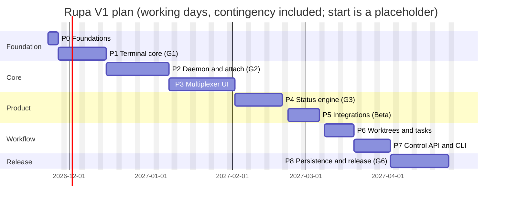

### 9.3 Release train and cut lines

| Release | Contents | Day (with $\kappa$) | What you can do with it |
|---|---|---|---|
| **Alpha 1** | P0–P2 | ≈ 33 | Run an agent in a daemon-owned pane, detach and reattach (**G2**) |
| **Alpha 2** | + P3 | ≈ 50 | A real multiplexer: panes, tabs, workspaces, mouse, copy |
| **Beta (daily driver)** | + P4, P5, plus P8-S1, S2, S4 (persistence, restore, crash isolation) | ≈ 80 | The product: status, inbox, hooks, notifications, restart-safe. **This is the recommended first thing to use for real work.** |
| **V0.9** | + P6, P7 | ≈ 98 | Worktree tasks and the scripting API |
| **V1.0** | + rest of P8 | ≈ 110 | Hardened, packaged, documented (**G6**) |

Beta's raw effort is $\sum_{p=0}^{5} d_p + d_{\text{P8-S1}} + d_{\text{P8-S2}} + d_{\text{P8-S4}} = 57.25 + 1 + 2 + 1 = 61.25$ days, so $61.25 \times 1.3 \approx 80$ days ≈ 15.9 weeks. If time is short, cut in this order: P7-S6, P6-S5/S6, P3-S9/S10, P7-S5 (the API primitives still work from the raw socket), and keep P4–P5 intact.

### 9.4 Gates

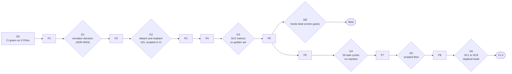

| Gate | Pass condition | If it fails |
|---|---|---|
| G0 | `cargo check` and CI green on three OSes | fix before anything else |
| **G1** | ADR-0003 merged with evidence from real Claude/Codex/OpenCode captures | implement `alacritty_terminal` `Screen` (2–4 days) and re-run |
| **G2** | detach/reattach scenario passes 20 times, then scripted in CI | stop; this is the architecture's foundation |
| **G3** | SC2 targets met on the golden set | tune §5.8.3 constants, add manifest rules, extend hooks; do not proceed to marketing the status feature |
| **GB** | with hooks installed, Claude Code and Codex report blocked/idle edges that beat the screen guess | fix hook mappers and installers before P6 |
| G4 | 50 worktree cycles clean | fix cleanup paths |
| G5 | fleet script works | simplify the API surface |
| **G6** | SC1–SC8 pass and dogfood log has no P0/P1 | no tag |

---

## 10. Testing strategy

### 10.1 Layers

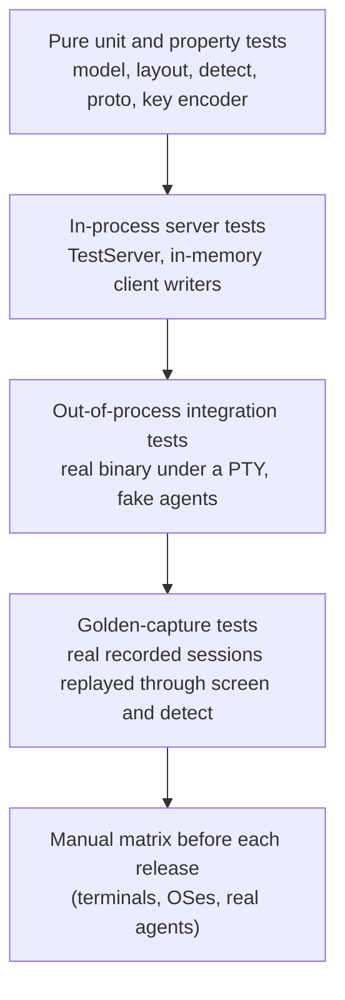

| Layer | What | Tools | Rule |
|---|---|---|---|
| L1 | layout tiling, rollup, reconciler truth table, manifest gates, wire codec, key encoder, screen patch/snapshot equivalence | `proptest`, plain tests | no PTYs; run in milliseconds |
| L2 | actor commands, event ring, render scheduler, geometry controller, multi-client | `TestServer`, in-memory writers | assert on decoded messages, not bytes |
| L3 | detach/reattach, restore, daemon lifecycle, hooks round-trip, worktree loop | spawn the real binary under `portable-pty`; `tests/fake-agent` | isolated runtime dir via `RUPA_RUNTIME_DIR`; a watchdog kills stray daemons; stop daemons with a graceful request, not `kill` |
| L4 | detection accuracy on recorded sessions | golden files + labelled timelines + `rupa-detect --eval` | **redact secrets**; each rule needs a positive and a negative fixture |
| L5 | human checks | checklist in `docs/release-checklist.md` | before each tag |

### 10.2 Fake agent

`tests/fake-agent` (P2-S12) is a **Rust** binary (no shell dependency on Windows) with scripted scenarios: spinner and title changes, a permission dialog, an idle prompt, a menu, a transcript viewer, subagent churn, and silence. It calls `rupa hook`/`rupa report` exactly like a real agent. **[V]** (herdr uses PATH shell scripts and reports they make hook and resume races deterministic.)

### 10.3 Golden captures and rot

Recorded CLI screens go stale as agents update. Mitigations: labelled intervals (not whole-screen equality), conjunction and negative gates in manifests, a refresh procedure (`pty-capture` → label → `manifest test`), and an `xfail` marker with an expiry date for a golden that an agent update broke, so CI stays green while the fix is pending. Detection code changes run the **evaluation** (§5.8.3 metrics), which fails CI if SC2 regresses.

### 10.4 Wire stability

Hand-written fixture bytes for `hello`, `welcome` and one error, checked in. A test fails if the serde types ever produce different bytes. **[V]** (herdr keeps its own hand-rolled bincode framing in test support for exactly this.)

### 10.5 Non-functional tests

| Test | Pass | Slice |
|---|---|---|
| Resize storm: 100 resizes in 1 s under heavy output | no hang, no corruption, final size correct | P1-S8 |
| Echo latency harness | SC3 | P1-S8, P8-S3 |
| Idle wakeups and CPU with 10 idle panes | SC4 | P8-S3 |
| Fuzz `Screen::process` with random bytes (10 minutes) | no panic | P8-S4 |
| Kill during session write | file never unreadable | P8-S1 |
| Output flood from one pane | other panes and clients stay responsive | P2-S6 |
| Network audit (1 h) | SC8 | P8-S5 |

### 10.6 CI

Per PR: fmt, clippy `-D warnings`, `cargo test --workspace` on three OSes, the detection evaluation (when relevant paths change), `cargo audit` and `cargo deny` (nightly schedule). Nightly: the fuzz run and the benchmark scenarios, with results kept as CI artifacts.

---

## 11. Risk register

Score $R = P \times I$ (probability and impact, each 1–5). Review at every gate.

| ID | Risk | P | I | R | Mitigation | Slice |
|---|---|---|---|---|---|---|
| R3 | Detection rots as agent UIs change | 5 | 4 | **20** | hooks where they exist; manifests as patchable data; golden regression; `explain`; version-stamped manifests | P4-S3, P4-S10 |
| R2 | ConPTY quirks (resize, handles, cleanup) consume weeks | 4 | 4 | **16** | Windows-first development; spikes in P1; budgeted $\kappa$; vendored patches if needed | P1-S2, P1-S5, P1-S8 |
| R5 | Scope creep toward herdr's breadth | 4 | 4 | **16** | §1.2 and §7.2 are the contract; changes follow §12.3 | all |
| R1 | `vt100` cannot render modern agent TUIs | 3 | 4 | 12 | `Screen` trait; G1; `alacritty_terminal` fallback costs 2–4 days | P1-S4 |
| R7 | Daemon detach fails in some launchers (jobs, SSH, IDE terminals, macOS Cmd-Q) | 3 | 4 | 12 | breakaway then WMI fallback on Windows; launchd job on macOS; manual matrix | P2-S3 |
| R13 | Key fidelity gaps (Shift+Enter, AltGr, IME) | 4 | 3 | 12 | key table tests; per-agent ADR; kitty protocol in V1.1 | P1-S7 |
| R15 | Agent hook or event APIs change | 4 | 3 | 12 | versioned installers; `doctor` drift check; screen fallback | P5-S7 |
| R6 | Solo estimate underrun or burnout | 4 | 3 | 12 | Beta cut line (§9.3); recalibrate $\kappa$ after P2 | §9 |
| R12 | Toolchain setup friction on Windows (MSVC) | 5 | 2 | 10 | P0-S1 first; documented | P0-S1 |
| R4 | Hooks behave differently from the docs (Windows quoting, `PermissionRequest` output) | 3 | 3 | 9 | verify in P5-S2/S3 before building installers | P5-S2 |
| R8 | Scrollback memory too high | 3 | 3 | 9 | line cap, measure, §5.16.2 formula | P1-S8 |
| R9 | Claude Code's own agent view absorbs the baseline | 3 | 3 | 9 | stay cross-vendor; own the cross-agent inbox | §7 |
| R10 | herdr's gravity (50k stars, funded) | 4 | 2 | 8 | do not compete on breadth; explainable status and privacy are the position | §7.1 |
| R11 | Local-socket security mistake | 2 | 4 | 8 | per-OS permission tests; checklist | P8-S5 |
| R14 | Licence or attribution error | 1 | 3 | 3 | NOTICE; study not copy; keep headers | P0-S6 |

---

## 12. Open decisions, deferrals, change process

### 12.1 Open decisions for you (none block P0)

| # | Question | Default if you do not decide |
|---|---|---|
| 1 | Project and binary name | `rupa` |
| 2 | Primary development OS | Windows 11 (per D12) |
| 3 | Which two agents get first-class hooks first | Claude Code and Codex (both installed here and well documented); OpenCode's plugin is third |
| 4 | Licence | MIT OR Apache-2.0 |
| 5 | Diff-review loop in V1 or V1.1 | V1.1 |

### 12.2 Deliberately deferred

| Item | Why deferred | Revisit when |
|---|---|---|
| Kitty keyboard protocol | `vt100` does not track it; modern key fidelity needs it; V1 uses xterm encoding | V1.1, after P1-S7's ADR shows which agents need it |
| ACP / MCP | helps only agents that speak them; the CLI agents in use do not need it | agents commonly expose ACP/MCP control |
| Scrollback persistence | size and corruption risk; herdr keeps a separate compressed file | V1.2 |
| SSH remote machines | large surface | V1.2 |
| Plugin system | needs installed base and a sandbox story | V2 |
| Windows ARM64 | herdr needs a dedicated workflow for it | on demand |
| Code signing and notarisation | cost and setup | when distributing widely |

### 12.3 Changing this spec

1. Reality contradicted the spec in a slice: fix the code **and** the spec in the same PR.
2. A decision in §0.4 changes: write an ADR (context, options, decision, consequences), update the register, and note the change in Appendix G.
3. New scope: add it to §7.2 first; promote it into a phase only by removing something of equal size.
4. Never loosen a success criterion in §1.3 without an ADR that explains why.

### 12.4 Assumptions still to validate (every **[A]** in this document)

| Assumption | Owner slice |
|---|---|
| `vt100` passes the §5.2.3 Must items on real captures | P1-S4 |
| Row hashing beats `state_diff` on cost and memory | P1-S8 |
| ConPTY needs no resize debounce beyond value-dedupe and coalescing | P1-S8 |
| Job Object assignment after spawn has no leak window | P1-S5 |
| Echo latency budget ($L_{\text{echo}}$ terms) | P1-S8 |
| $b_{\text{cell}} \approx 48$ B and the memory table | P1-S8 |
| `CREATE_BREAKAWAY_FROM_JOB` works where WMI is needed today | P2-S3 |
| Reliability priors $\rho$, $k_b$, $T_{\text{clear}}$, $T_{\text{stale}}$, and the 0.3 conflict penalty | P4-S10 |
| Empty-stdout exit-0 `PermissionRequest` hook leaves Claude's dialog alone | P5-S2 |
| Hook command quoting on Windows; `Notification` matcher semantics | P5-S3 |
| Hook per `PostToolUse` costs about 10 ms | P5-S2 |
| Codex and OpenCode resume flags | P5-S6 |
| OpenCode plugin shape and event names on the installed version | P5-S5 |
| Shift+Enter encoding for each agent | P1-S7 |
| $\kappa = 0.30$ | after P2 |
| Minimum pane size (8 × 3) and 16-client limit | P3-S1, P2-S4 |

---

## Appendix A — Starting manifests

> **Attribution and caution.** The strings below are a *starting point* taken from patterns observed in herdr's Apache-2.0 manifests (`src/detect/manifests/*.toml`, herdr 0.9.5) and from the research reports. CLI wording changes between releases. P4-S3 replaces every string with one derived from **your own** golden captures. Keep herdr's credit in `NOTICE` if any text is copied verbatim.

### A.1 `claude.toml`

```toml
id = "claude"
version = "2026.11.15.1"
aliases = ["claude-code"]

[[rules]]
id = "title_spinner_working"
state = "working"
priority = 1100
region = "title"
reason = "title spinner"
regex = ['^[\x{2800}-\x{28FF}\x{25D0}-\x{25D3}] ']

[[rules]]
id = "blocked_form"
state = "blocked"
priority = 980
region = "after_last_rule"
reason = "menu or dialog waiting for input"
contains = ["esc to cancel"]
any = [
  { contains = ["enter to confirm"] },
  { contains = ["enter to select"], any = [
      { contains = ["arrow keys to navigate"] },
      { contains = ["↑/↓ to navigate"] },
      { contains = ["↑↓ to navigate"] },
  ] },
]

[[rules]]
id = "permission_dialog"
state = "blocked"
priority = 960
region = "tail_nonempty(20)"
reason = "permission prompt"
contains = ["do you want to proceed?"]

[[rules]]
id = "working_interrupt_hint"
state = "working"
priority = 900
region = "tail_nonempty(12)"
reason = "esc to interrupt"
line_regex = ['^\s*[⏸⏵].*esc to interrupt(?:\s|·|$)']
not = [ { contains = ["do you want to proceed?"] }, { contains = ["esc to cancel"] } ]

[[rules]]
id = "idle_prompt"
state = "idle"
priority = 300
region = "prompt_box"
reason = "at prompt"
line_regex = ['^\s*❯']
not = [ { contains = ["enter to select"] }, { contains = ["esc to cancel"] } ]

[[rules]]
id = "transcript_viewer"
state = "unknown"
skip_state_update = true
priority = 1000
region = "whole_tail"
contains = ["showing detailed transcript"]
```

### A.2 `codex.toml`

```toml
id = "codex"
version = "2026.11.15.1"

[[rules]]
id = "title_action_required"
state = "blocked"
priority = 1100
region = "title"
reason = "action required"
contains = ["Action Required"]

[[rules]]
id = "title_spinner_working"
state = "working"
priority = 1050
region = "title"
reason = "title spinner"
regex = ['[\x{2800}-\x{28FF}]']

[[rules]]
id = "trust_directory"
state = "blocked"
priority = 950
region = "top_nonempty(12)"
reason = "directory trust prompt"
contains = ["Do you trust the contents of this directory?"]

[[rules]]
id = "generic_confirm"
state = "blocked"
priority = 900
region = "tail_nonempty(8)"
reason = "confirmation"
any = [ { contains = ["[y/n]"] }, { contains = ["press enter to confirm or esc to cancel"] }, { contains = ["allow command?"] } ]
```

### A.3 `opencode.toml`

```toml
id = "opencode"
version = "2026.11.15.1"

[[rules]]
id = "permission_required"
state = "blocked"
priority = 980
region = "tail_nonempty(15)"
reason = "permission required"
contains = ["△ Permission required"]

[[rules]]
id = "blocked_dialog"
state = "blocked"
priority = 950
region = "tail_nonempty(12)"
reason = "dialog waiting"
contains = ["esc dismiss"]
any = [ { contains = ["enter confirm"] }, { contains = ["enter submit"] }, { contains = ["enter toggle"] } ]

[[rules]]
id = "interrupt_working"
state = "working"
priority = 800
region = "tail_nonempty(12)"
reason = "interrupt hint"
any = [ { contains = ["esc to interrupt"] }, { contains = ["ctrl+c to interrupt"] }, { regex = ['(■|⬝){4,}'] } ]
```

---

## Appendix B — Hook and plugin configurations

`<RUPA>` stands for the absolute path of the rupa executable, written by `rupa integrate` (§5.9.6). Quote it per OS. Timeouts are seconds for Claude and Codex.

### B.1 Claude Code — `~/.claude/settings.json` (`hooks` object) **[R]**

```json
{
  "hooks": {
    "SessionStart": [
      { "matcher": "^(startup|resume|clear|compact|fork)$",
        "hooks": [ { "type": "command", "command": "\"<RUPA>\" hook claude", "timeout": 5 } ] }
    ],
    "UserPromptSubmit":   [ { "hooks": [ { "type": "command", "command": "\"<RUPA>\" hook claude", "timeout": 5 } ] } ],
    "PermissionRequest":  [ { "matcher": "*", "hooks": [ { "type": "command", "command": "\"<RUPA>\" hook claude", "timeout": 5 } ] } ],
    "PostToolUse":        [ { "matcher": "*", "hooks": [ { "type": "command", "command": "\"<RUPA>\" hook claude", "timeout": 5 } ] } ],
    "PostToolUseFailure": [ { "matcher": "*", "hooks": [ { "type": "command", "command": "\"<RUPA>\" hook claude", "timeout": 5 } ] } ],
    "Stop":               [ { "hooks": [ { "type": "command", "command": "\"<RUPA>\" hook claude", "timeout": 5 } ] } ],
    "StopFailure":        [ { "hooks": [ { "type": "command", "command": "\"<RUPA>\" hook claude", "timeout": 5 } ] } ],
    "SubagentStart":      [ { "hooks": [ { "type": "command", "command": "\"<RUPA>\" hook claude", "timeout": 5 } ] } ],
    "SubagentStop":       [ { "hooks": [ { "type": "command", "command": "\"<RUPA>\" hook claude", "timeout": 5 } ] } ],
    "Notification":       [ { "matcher": "elicitation_dialog|elicitation_url_dialog",
                              "hooks": [ { "type": "command", "command": "\"<RUPA>\" hook claude", "timeout": 5 } ] } ],
    "SessionEnd":         [ { "hooks": [ { "type": "command", "command": "\"<RUPA>\" hook claude", "timeout": 5 } ] } ]
  }
}
```

The same command serves every event: `rupa hook claude` reads `hook_event_name` from the JSON on stdin. Entries merge with the user's own hooks; Claude merges hooks across settings levels. **[R]** Verify in P5-S3: the `Notification` matcher semantics, Windows quoting, and that nothing on stdout means "no decision".

### B.2 Codex — `~/.codex/hooks.json` **[R]**

```json
{
  "hooks": {
    "SessionStart":      [ { "matcher": "startup|resume", "hooks": [ { "type": "command", "command": "\"<RUPA>\" hook codex", "timeout": 5 } ] } ],
    "UserPromptSubmit":  [ { "hooks": [ { "type": "command", "command": "\"<RUPA>\" hook codex", "timeout": 5 } ] } ],
    "PermissionRequest": [ { "matcher": "*", "hooks": [ { "type": "command", "command": "\"<RUPA>\" hook codex", "timeout": 5 } ] } ],
    "PostToolUse":       [ { "matcher": "*", "hooks": [ { "type": "command", "command": "\"<RUPA>\" hook codex", "timeout": 5 } ] } ],
    "Stop":              [ { "hooks": [ { "type": "command", "command": "\"<RUPA>\" hook codex", "timeout": 5 } ] } ],
    "Interrupt":         [ { "hooks": [ { "type": "command", "command": "\"<RUPA>\" hook codex", "timeout": 3 } ] } ],
    "SessionEnd":        [ { "hooks": [ { "type": "command", "command": "\"<RUPA>\" hook codex", "timeout": 3 } ] } ]
  }
}
```

First run prints a warning; review and trust the hooks once with `/hooks` (or start with `--dangerously-bypass-hook-trust` for automation). On Windows add `"commandWindows"` where the quoting differs. Hooks are on by default (`[features] hooks`); do not mix `hooks.json` and an inline `[hooks]` table in one config layer. **[R]**

### B.3 OpenCode — `~/.config/opencode/plugins/rupa-agent-state.js` **[A: shape verified in P5-S5]**

```js
import { spawn } from "node:child_process";

const BIN = process.env.RUPA_BIN_PATH || "rupa";
// Only a process that owns its local lifecycle can tell which session its pane shows (herdr applies the same rule).
const argv = process.argv.join(" ");
const OWNS_LIFECYCLE = !/\b(serve|web|attach)\b/.test(argv);
const BLOCKED = new Set(["permission.asked", "question.asked", "session.error"]);
const WORKING = new Set(["tool.execute.before", "tool.execute.after", "permission.replied",
                         "question.replied", "question.rejected", "session.compacted"]);

function send(state, sessionID, parentID) {
  if (process.env.RUPA_ENV !== "1" || !process.env.RUPA_PANE_ID) return;
  try {
    const p = spawn(BIN, ["hook", "opencode"], { stdio: ["pipe", "ignore", "ignore"] });
    p.on("error", () => {});
    p.stdin.end(JSON.stringify({ state, sessionID, parentID }));
  } catch {}
}

export const RupaState = async () => !OWNS_LIFECYCLE ? ({}) : ({
  "chat.message": async ({ sessionID }) => send("working", sessionID),
  event: async ({ event }) => {
    const type = event?.type;
    const p = event?.properties ?? {};
    const sid = p.sessionID ?? p.info?.id;
    const parent = p.info?.parentID;
    if (type === "session.idle") return send("idle", sid, parent);
    if (BLOCKED.has(type)) return send("blocked", sid, parent);
    if (WORKING.has(type)) return send("working", sid, parent);
    if (type === "session.status") {
      const s = p.status;
      const kind = (typeof s === "string" ? s : s?.type || "").toLowerCase();
      return send(kind === "idle" ? "idle" : "working", sid, parent);
    }
  },
});

export default { id: "local.rupa-state", server: RupaState, setup() {} };
```

Skip when OpenCode runs as `serve`, `web` or `attach` (it cannot identify its pane); `rupa hook opencode` additionally ignores reports with no `RUPA_PANE_ID`. **[V]** (herdr does the same.)

---

## Appendix C — Environment variables

| Variable | Set by | Meaning |
|---|---|---|
| `RUPA_ENV` | daemon | `1` inside a rupa pane |
| `RUPA_SOCKET_PATH` | daemon | endpoint for hooks and CLI |
| `RUPA_PANE_ID`, `RUPA_TAB_ID`, `RUPA_WORKSPACE_ID` | daemon | where this process lives |
| `RUPA_SESSION` | daemon, user | session name (default `default`) |
| `RUPA_BIN_PATH` | daemon | absolute path of the rupa executable |
| `RUPA_TASK`, `RUPA_WORKTREE`, `RUPA_PORT_BASE` | daemon | task tab context |
| `RUPA_CONFIG_DIR`, `RUPA_STATE_DIR`, `RUPA_RUNTIME_DIR` | user, tests | override directories |
| `RUPA_LOG` | user | log level (`error`…`trace`) |
| `RUPA_STARTUP_CWD` | launcher → daemon | seeds the first workspace |
| `RUPA_DISABLE_SOUND` | user | silence notification sounds |

## Appendix D — Glossary

| Term | Meaning |
|---|---|
| Pane | one PTY with its screen and (maybe) an agent |
| Tab | a layout of panes; the unit of a task |
| Workspace | a group of tabs, usually one repo |
| Session | one daemon instance and its socket (`--session`) |
| Agent | a recognised AI CLI process inside a pane |
| Hook | a command the agent runs on a lifecycle event |
| Manifest | TOML rules that read the screen to infer state |
| Geometry controller | the one client whose size drives a tab's PTY sizes |
| Snapshot / patch | full screen rebuild / changed rows only |
| Golden | a recorded real session used as a regression fixture |
| ADR | architecture decision record in `docs/adr/` |
| FIR | false-idle rate (§5.8.3) |

## Appendix E — herdr reference constants **[V]** (from source)

| Constant | Value | Where |
|---|---|---|
| Protocol version / frame cap | 22 (exact match) / 2 MiB (32 MiB graphics) | `src/protocol/wire.rs` |
| Event ring | 512 | `src/api/event_hub.rs` |
| Detection tick (`TICK_IDENTIFIED`) | 300 ms | `src/pane.rs` |
| Idle recheck / confirmations / cap (applied only to working→idle with no visible idle prompt or blocker) | 100 ms / 3 / 700 ms | `src/pane/agent_detection.rs` |
| Detection tail rows | 24 | `src/pane/terminal.rs` |
| Startup grace / visible signal refresh | 3 s / 800 ms | same |
| Process probe cadence | 5 s identified; 8 s acquisition; 500 ms fast, 2 s slow; 6 miss confirmations | `src/pane.rs` |
| Split ratio clamp | 0.1–0.9 | `src/layout.rs` |
| Min render interval | 16 ms | `src/app/mod.rs` |
| Scrollback limit | 10,000,000 bytes | `src/config.rs` |
| Snapshots | version 3; 3 backups; 48 periodic at 15 min | `src/persist` |
| Manifest limits | 128 rules, depth 8, 512 gates, 32 matchers/gate, 1,024 total, 512 chars | `src/detect/manifest.rs` |
| Daemon readiness | poll 50 ms, timeout 15 s | `src/server/autodetect.rs` |
| Handshake timeouts | 5 s local, 60 s remote | `src/client/handshake.rs` |
| PTY reader buffer / input queue | 8 KiB / 1024 | `src/pty/actor*.rs` |

## Appendix F — Source reports

| File | Use it for |
|---|---|
| `reference/herdr/research/r1-herdr-product.md` | product surface, CLI, docs quotes |
| `reference/herdr/research/r2-herdr-code.md` | repo layout (note the OSC 7501 error, §2.4) |
| `reference/herdr/research/r3-landscape.md` | competing tools and table stakes |
| `reference/herdr/research/r4-rust-stack.md` | background only; versions are stale |
| `reference/herdr/research/r5-user-demand.md` | feature demand and the 15 recurring bugs, with issue links |
| `reference/herdr/research/r6-agent-hooks.md` | per-agent hook configs, payloads, literal screen strings (Cursor, Copilot, Gemini, Amp, Aider included) |
| `reference/herdr/research/r7a-herdr-internals.md` | layout, protocol, persistence, detection, PTY and Windows internals |
| `reference/herdr/research/r7b-herdr-internals.md` | input, worktrees, daemon lifecycle, rendering, tests, bug history |
| `spikes/pty-capture/` | the capture and replay tool: written but **never built** (no MSVC linker on the author's machine); promoted to `tools/pty-capture` in P1-S1 |

---

## Appendix G — Audit log

### G.1 Method

| Pass | What was done |
|---|---|
| Self-checks (scripted) | every `§` reference resolves; every slice id in a dependency exists; the dependency graph is acyclic and never points to a later phase; all 18 Mermaid diagrams parse with the real Mermaid 11 parser; every display formula has balanced braces and no control characters; slice, task and day totals in §9 are generated from the slice list, not typed |
| Numeric checks | memory table, port-block count, frame rate, wakeup budget, layout identity and noisy-OR examples recomputed independently |
| Source checks | herdr constants in Appendix E and §5 compared with the cloned source (ratio clamp, event ring 512, protocol 22, frame cap, render interval, detection rows, manifest limits, idle-hold condition, tick location); `vt100` 0.18.1 API checked in its source (`state_formatted`, `state_diff`, `rows_formatted`, mode getters, callbacks, `Screen: Clone`) |
| Environment checks | toolchain facts tested on the author's machine: no MSVC linker; Git Bash `link` shadowing; `claude`, `codex`, `opencode` installed; `pwsh`, `tmux`, `gemini` absent; crate versions via `cargo search` |
| Independent review | a separate reviewer read the whole spec cold, with the research reports and the herdr source, and reported 5 critical, 19 important and 20 minor findings plus about 40 confirmed-correct claims |

### G.2 Corrections made to the research (before the spec)

| Source | Claim | Truth |
|---|---|---|
| r2 | herdr hooks use OSC 7501 | No `7501` anywhere in the TUI source; hooks call the CLI over the socket **[V]** |
| r4 | `agent-client-protocol` 0.2, `rmcp` 0.1, `bincode` 1.3, `toml` 0.8, `tokio` 1.43 | 5.2.0, 3.10.0, 3.0.0, 1.x, 1.54 **[V]** |
| r3 | "wrap tmux" | tmux is absent on the author's Windows machine **[V]** |
| PLAN.md | "hooks-first" status | herdr's maintainers removed lifecycle hooks for four agents and rely on screens **[V]**; the spec measures instead (D6) |
| PLAN.md | client keeps its own emulator fed raw bytes | server-authoritative snapshot and patches (D4) |

### G.3 Findings of the independent review and what was done

| ID | Finding | Resolution |
|---|---|---|
| C1 | `vt100` never answers terminal queries (CSI 6n, DA, OSC 10/11); Codex and OpenCode can stall | `take_responses()` on the trait; must-pass checklist row; tasks in P1-S3, P1-S4, P1-S6, P2-S5 |
| C2 | A 1 Hz timer cannot implement the hysteresis and breaks the 1 s detection target | one-shot 100 ms recheck timer while pending, deadline timers for time rules; formulas and bound re-derived (≈ 0.23 s) |
| C3 | Dependency cycles (P2-S10, P4-S6/S7, P5-S1/S6, P8-S2) | fake agent split into its own slice; reconciler tested with injected signals; resume verification vs restart test separated |
| C4 | Nothing built the multi-pane server path or the client frame consumer | new slices P2-S11 and P3-S11 |
| C5 | Nothing set `RUPA_*` in pane environments, so hooks would silently no-op | task in P2-S5, `doctor` check in P5-S7, rationale in §5.1 |
| I1 | research reports r5–r7b and the spike were not in the repo | copied to `reference/herdr/research/` and `spikes/pty-capture/` |
| I2 | title and manifest signals double-counted | a manifest yields at most two signals (§5.8.2) |
| I3 | "immediate" blocked versus 2-sample hysteresis | hysteresis applies to screen signals only; hook edges immediate |
| I4 | the clear-after-1.5-s rule would erase unrecognised blocked states | requires input sent or a blocked rule that stopped matching; truth-table rows 8 and 16 |
| I5 | subagent permission prompts would be swallowed | subagent permission and elicitation events still set `blocked` |
| I6 | OpenCode plugin design contradicted herdr's | re-tagged; P5-S5 decides server versus TUI plugin; argv gate added to Appendix B.3 |
| I7 | macOS daemon dies when the terminal app quits | launchd one-shot job (P2-S3, §5.5) |
| I8 | pane rects need the client's content area | `content_cols/rows` in `attach.open` and `attach.resize` |
| I9 | `Screen` trait not object-safe | non-generic trait plus `AnyScreen` enum |
| I10 | scrolled view cloned the whole screen per wheel tick | set, format and restore `set_scrollback` under the mutex; `pane.text` for copy mode and search |
| I11 | Windows job-assignment race; WMI loses the environment | job on the daemon itself; WMI passes environment and cwd |
| I12 | `runtime_dir` missing on macOS/Windows; macOS path length | own resolver, length assertion (P0-S4) |
| I13 | tests used `cat` and Ctrl+D | `tests/echo-child` |
| I14 | undersized slices and non-atomic tasks | P1-S1, P1-S3, P1-S4 resized; P2-S10 split; long tasks split; dogfood split into P8-S8 and P8-S9 |
| I15 | designed features with no slice | added to P2-S9, P3-S4, P3-S6, P3-S8, P3-S9, P3-S11, P5-S1, P8-S1, P8-S3 and §5.14 |
| I16 | `prefix+d` bound twice | diff popup is `prefix+e`; duplicate-default test |
| I17 | 500 ms connect versus 400 ms hook budget | 150 ms connect, 400 ms hard deadline |
| I18 | P4-S7 test contradicted "plain shells have no status" | reworded; agent profiles count as identified |
| I19 | per-pane process scans break the CPU budget | one aligned snapshot tick; 30 s for unidentified panes; formula updated |
| Minor | 20 items (gate names, regions, priority-band claim, tick location, cell size, `?1007`, session fields, `since_ms`, base64, nesting guard, CI scripting, elevation, restore semantics, session-kill, eval command, `reference/herdr/src` handling, prefix note, grammar-based property tests, V0.9 day) | all applied, see the diff of this file |

### G.4 What is still not proven

Everything tagged **[A]** is listed with its owning slice in §12.4. The most important:

1. **Nothing in this spec has been compiled or run.** The author's machine cannot build Rust until the MSVC Build Tools are installed (P0-S1), so the capture/replay spike in `spikes/pty-capture/` is untested and the `vt100` fidelity question (Gate G1) is open. The design deliberately puts that question first.
2. **Hook behaviour on Windows** (quoting, empty-stdout semantics, per-event cost) and **OpenCode's plugin shape** come from documentation and from herdr's plugin, not from running them.
3. **The reconciler constants** ($\rho$, $k_b$, $T_{\text{clear}}$, $T_{\text{stale}}$, the 0.3 penalty) are starting values until the calibration slice (P4-S10) measures them on recorded sessions.
4. **Effort estimates** ($\kappa = 0.30$) are judgment; the first honest calibration point is the end of Phase 2.
5. Reddit sentiment was never sampled (blocked); conclusions come from Hacker News and GitHub issues.

### G.5 Residual risk in one paragraph

The riskiest parts are exactly the ones the plan front-loads: terminal fidelity (Gate G1), Windows PTY and detach behaviour (P1-S5, P2-S3), and detection accuracy against agents that change their UI (Gate G3). If G1 or G2 fails badly, stop and re-plan before building the multiplexer on top. If you only have time for part of the plan, the Beta cut in §9.3 is the smallest thing worth using daily.
